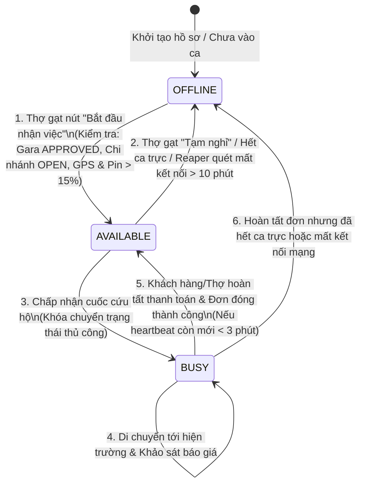
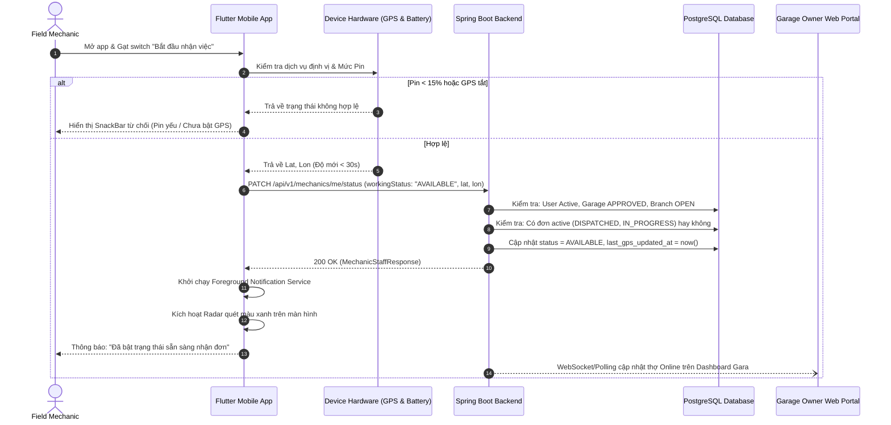

# UC-07: Bật/Tắt Trạng thái Trực tuyến của Thợ Cứu hộ (Toggle Online / Offline Status)

**Mã Use Case:** UC-07  
**Tên Use Case:** Bật/Tắt Trạng thái Trực tuyến của Thợ Cứu hộ (Toggle Online / Offline Status)  
**Actor chính:** Field Mechanic (Nhân viên sửa xe / cứu hộ hiện trường)  
**Actor liên quan / Actor phụ:** Garage Owner (Chủ gara), Dispatch Engine (Hệ thống điều phối cứu hộ), Customer (Khách hàng gặp nạn)  
**Phạm vi hệ thống:** Phân hệ Thợ cứu hộ (`features/mechanic`), Phân hệ Điều phối Cứu hộ (`features/rescue`), Ứng dụng Di động Flutter & Cổng Quản trị Đối tác Web  
**Độ ưu tiên:** Rất cao (Critical)  
**Ngày cập nhật:** 31/10/2026 (Phiên bản giải quyết triệt để xung đột ca trực, kiểm soát định vị Stale và chạy ngầm)  

---

## 1. Mô tả Nghiệp vụ (Business Overview)

Use Case này cho phép Thợ cứu hộ hiện trường (`FIELD_MECHANIC`) chủ động quản lý trạng thái sẵn sàng làm việc của mình trên ứng dụng di động:
- **Chuyển đổi trạng thái linh hoạt:** Giữa **Sẵn sàng nhận đơn (`AVAILABLE`)** và **Tạm nghỉ / Ngoại tuyến (`OFFLINE`)** theo nhu cầu thực tế tại hiện trường mùa mưa bão.
- **Tích hợp cảm biến định vị GPS thời gian thực:** Thu thập tọa độ vị trí chính xác của thợ ngay tại thời điểm bật trực tuyến và định kỳ gửi tín hiệu sống (Heartbeat) để làm mới dữ liệu không gian trên hệ thống điều phối cứu hộ.
- **Độc quyền tiếp nhận cuốc (Concurrency Control):** Khi thợ tiếp nhận ca cứu hộ khẩn cấp hoặc chở xe vượt ngập, hệ thống tự động khóa trạng thái thợ thành **Đang bận (`BUSY`)** và ngăn chặn thợ tự ý thay đổi trạng thái nhằm tránh hành vi bỏ rơi khách hàng đang mắc kẹt giữa đường ngập lụt.
- **Giải quyết hài hòa giữa Ca trực phân công và Quyết định cá nhân:** Hệ thống hỗ trợ thợ tạm nghỉ hợp lệ trong ca làm việc (ăn uống, tiếp nhiên liệu, bảo dưỡng phương tiện cứu hộ) đồng thời cho phép thợ đăng ký **Tăng ca trực chiến (Overtime)** ngoài khung giờ phân công để hỗ trợ cứu nạn trong các đợt bão lớn hoặc triều cường dâng cao.
- **Cơ chế bảo vệ nguồn lực tự động (Auto-Offline Reaper):** Tự động phát hiện và hạ ngoại tuyến các thiết bị mất kết nối, tắt sóng 4G hoặc sập nguồn pin quá thời gian quy định nhằm triệt tiêu các "cuốc ma" trên hệ thống điều phối.

### 1.1. User Stories
* **Là một Thợ cứu hộ hiện trường (`Field Mechanic`):**
  * Tôi muốn gạt công tắc nhận việc khi đã sẵn sàng trang thiết bị để hệ thống bắt đầu điều phối các cuốc cứu hộ xe ngập nước trong khu vực gần tôi nhất.
  * Tôi muốn có thể tạm nghỉ tối đa 45 phút trong ca trực khi cần ăn trưa hoặc đổ xăng mà không bị hệ thống tự động cưỡng chế nhận cuốc.
  * Tôi muốn có thể bật trực tuyến tăng ca ngoài giờ khi thấy địa bàn đang có mưa bão ngập nặng để tăng thêm thu nhập và hỗ trợ người dân.
* **Là một Chủ Gara (`Garage Owner`):**
  * Tôi muốn giám sát trực quan trạng thái thực tế của từng nhân viên (Đang trực tuyến, Đang bận cứu hộ, Đang nghỉ) trên bản đồ điều hành để phân bổ nhân lực chi nhánh hợp lý.
  * Tôi muốn hệ thống ghi nhận chính xác thời gian bắt đầu ca trực và thời gian làm thêm giờ của thợ để làm căn cứ chấm công và tính thưởng minh bạch.
* **Là Hệ thống Điều phối Cứu hộ (`Dispatch Engine`):**
  * Tôi chỉ quét và gán đơn cứu hộ cho những thợ có trạng thái `AVAILABLE`, có tọa độ GPS hợp lệ và được cập nhật mới nhất trong vòng 3 phút trở lại, thuộc chi nhánh đang mở cửa (`OPEN`).

---

## 2. Điều kiện Tiên quyết (Pre-conditions)

Để thợ có thể chuyển trạng thái sang `AVAILABLE`, toàn bộ 5 điều kiện sau đây **bắt buộc phải thỏa mãn đồng thời**:
- **PRE-1 (Tài khoản hoạt động):** Tài khoản thợ đã đăng nhập thành công vào ứng dụng di động Flutter và đang ở trạng thái kích hoạt (`user.active = true`, `role = 'ROLE_FIELD_MECHANIC'`).
- **PRE-2 (Gara hợp lệ):** Gara chủ quản của thợ đã được nhân viên vận hành (Staff) phê duyệt chính thức (`garage.status = 'APPROVED'`). Gara ở trạng thái `PENDING`, `REJECTED` hoặc `SUSPENDED` sẽ bị chặn nhận việc.
- **PRE-3 (Chi nhánh mở cửa):** Thợ đã được phân bổ vào một chi nhánh cụ thể (`branch != null`) và chi nhánh đó đang mở cửa hoạt động (`branch.operatingStatus = 'OPEN'`).
- **PRE-4 (Phần cứng GPS & Quyền vị trí):** Thiết bị di động của thợ đã bật dịch vụ định vị (Location Services) và ứng dụng đã được cấp quyền truy cập vị trí chính xác (`ACCESS_FINE_LOCATION`) cùng quyền chạy ngầm (`ACCESS_BACKGROUND_LOCATION`).
- **PRE-5 (Mức pin an toàn):** Dung lượng pin của thiết bị di động phải đạt từ **15% trở lên** (hoặc đang cắm sạc) theo quy định an toàn cứu hộ khẩn cấp (`BR-MECH-004`).

---

## 3. Điều kiện Sau thực hiện (Post-conditions)

- **POST-1:** Trạng thái làm việc của thợ được cập nhật chuẩn xác (`AVAILABLE` hoặc `OFFLINE`) trong bảng `mechanic_staffs` của cơ sở dữ liệu.
- **POST-2:** Thời điểm cập nhật trạng thái (`updated_at`), thời điểm tín hiệu sống (`last_heartbeat_at`) và thời điểm định vị (`last_gps_updated_at`) được ghi nhận chi tiết.
- **POST-3:** Khi bật `AVAILABLE`, thợ được đưa vào hàng đợi không gian (Geospatial Dispatch Queue) trong bán kính phục vụ của chi nhánh để sẵn sàng nhận cuốc cứu hộ mới. Ngược lại, khi chuyển `OFFLINE`, thợ lập tức bị rút khỏi tập ứng viên điều phối.
- **POST-4:** Ứng dụng di động kích hoạt Foreground Service hiển thị thông báo thường trực trên thanh trạng thái thiết bị để duy trì luồng gửi tọa độ GPS định kỳ không bị ngắt quãng.
- **POST-5:** Cổng điều hành Web của Chủ gara (`GarageOperationsView`) lập tức đồng bộ số lượng thợ trực tuyến theo thời gian thực.

---

## 4. Mô hình Hóa Trạng thái & Kiến trúc Luồng

### 4.1. Biểu đồ State Machine của Thợ Cứu hộ (Mechanic State Machine)



### 4.2. Biểu đồ Sequence Diagram Luồng Bật Trực tuyến & Gửi Định vị



---

## 5. Các Luồng Nghiệp vụ Chi tiết (Use Case Flows)

### 5.1. Luồng chính (Normal Flow) – Bật Trực tuyến Sẵn sàng Nhận việc
1. Thợ mở ứng dụng di động `Flood Rescue Mechanic` trên điện thoại.
2. Thợ kiểm tra thông tin chi nhánh trực thuộc và ca làm việc được phân công trên màn hình chính (`MechanicHomeScreen`) hoặc tab Ca trực (`MechanicShiftScreen`).
3. Thợ gạt công tắc nhận việc sang **"BẬT TRỰC TUYẾN"** (hoặc bấm nút *"Bắt đầu nhận việc"*).
4. Ứng dụng đọc thông số phần cứng thiết bị:
   - Kiểm tra dịch vụ GPS đang bật và quyền vị trí ngầm đã được cấp.
   - Kiểm tra dung lượng pin còn lại $\ge 15\%$.
   - Thu thập tọa độ GPS hiện tại (với độ chính xác cao và thời gian đo không quá 30 giây).
5. Ứng dụng gửi yêu cầu `PATCH /api/v1/mechanics/me/status` kèm tọa độ lên Backend.
6. Hệ thống Backend xác minh toàn diện:
   - Tài khoản thợ đang kích hoạt.
   - Gara chủ quản đang ở trạng thái `APPROVED`.
   - Chi nhánh trực thuộc đang mở cửa (`BranchStatus.OPEN`).
   - Thợ không vướng bất kỳ đơn hàng nào đang xử lý dở dang.
7. Backend cập nhật `working_status = 'AVAILABLE'`, lưu tọa độ kinh độ/vĩ độ, cập nhật `last_heartbeat_at = now()` và `last_gps_updated_at = now()`.
8. Ứng dụng nhận phản hồi thành công:
   - Khởi chạy Android Foreground Service với thông báo thường trực trên khay hệ thống.
   - Hiển thị hiệu ứng Radar quét tìm cuốc cứu hộ màu xanh kèm vị trí hiện tại.
   - Thợ bước vào trạng thái sẵn sàng chờ thuật toán điều phối gán cuốc khẩn cấp.

---

### 5.2. Luồng phụ 1 (Alternative Flow 1) – Tạm nghỉ Hợp lệ Giữa ca (Manual Break)
1. Trong ca làm việc được phân công, thợ có nhu cầu tạm nghỉ cá nhân (ăn trưa, tiếp nhiên liệu, bảo dưỡng xe).
2. Thợ gạt công tắc về phía **"TẠM NGHỈ"**.
3. Ứng dụng hiển thị hộp thoại xác nhận:
   - Cho phép chọn lý do tạm nghỉ (*Nghỉ ăn uống*, *Đổ xăng/Bảo dưỡng xe*, *Sự cố cá nhân*).
   - Hiển thị thông báo thời gian tạm nghỉ tối đa được khuyến nghị là **45 phút**.
4. Thợ bấm xác nhận *"Bắt đầu tạm nghỉ"*.
5. Hệ thống kiểm tra điều kiện:
   - Thợ hiện **không có đơn cứu hộ nào đang xử lý dở dang** (`DISPATCHED`, `ARRIVED`, `IN_PROGRESS`).
6. Hệ thống cập nhật:
   - `working_status = 'OFFLINE'`.
   - `is_manual_override = true` (Đánh dấu quyết định tạm nghỉ thủ công của thợ).
   - `paused_at = now()`, `pause_reason = [Lý do đã chọn]`.
7. Hệ thống loại thợ khỏi hàng đợi điều phối cứu hộ để không bắn cuốc mới tới thợ trong lúc nghỉ ngơi.
8. **Đảm bảo không xung đột với Ca trực:** Tác vụ quét ca trực định kỳ (`syncAllMechanicsShiftStatuses`) nhận diện cờ `is_manual_override = true` nên **tuyệt đối không tự ý gạt ngược lại thành `AVAILABLE`**.
9. Sau 45 phút, ứng dụng bắn thông báo nhắc: *"Thời gian tạm nghỉ của bạn đã hết. Hãy bật lại trực tuyến để tiếp tục hỗ trợ cứu hộ!"*. Khi thợ gạt bật lại, cờ `is_manual_override` được đặt lại về `false`.

---

### 5.3. Luồng phụ 2 (Alternative Flow 2) – Tăng ca Trực chiến Mùa bão Ngoài giờ (Emergency Overtime)
1. Thợ đang ở ngoài khung giờ làm việc được phân công (ví dụ lúc 23:30 đêm), nhận thấy thời tiết mưa to, đường phố ngập sâu và có nhu cầu bật ứng dụng tăng ca hỗ trợ người dân.
2. Thợ mở app và gạt switch sang **"BẬT TRỰC TUYẾN"**.
3. Ứng dụng phát hiện thời gian hiện tại nằm ngoài ca làm việc chính thức (`shiftName`), hiển thị hộp thoại xác nhận:
   * *"Bạn đang bật trực tuyến ngoài ca làm việc được phân công. Bạn có muốn kích hoạt chế độ TĂNG CA TRỰC CHIẾN (Overtime) không?"*
4. Thợ chọn *"Xác nhận Tăng ca"*.
5. Hệ thống cập nhật `working_status = 'AVAILABLE'`, đánh dấu cờ `is_manual_override = true` để cronjob không tự động ép thợ về `OFFLINE`.
6. Tất cả các đơn cứu hộ được thợ tiếp nhận trong khoảng thời gian này sẽ được gắn thẻ phụ trợ `is_overtime = true` để chủ Gara dễ dàng đối soát trả thêm tiền thưởng vượt chỉ tiêu cứu nạn mùa bão.

---

### 5.4. Luồng phụ 3 (Alternative Flow 3) – Duy trì Tín hiệu Sống & Định vị Chạy ngầm (Background Heartbeat)
1. Khi thợ đang ở trạng thái `AVAILABLE`, ứng dụng chạy ngầm Foreground Service trên thiết bị.
2. Định kỳ mỗi **30 giây** (hoặc khi thiết bị di chuyển vượt quá 20 mét):
   - Service tự động đọc tọa độ GPS mới nhất từ phần cứng.
   - Gửi yêu cầu ngầm `POST /api/v1/mechanics/me/heartbeat` lên Backend kèm tọa độ GPS mới.
3. Backend tiếp nhận, làm mới trường `last_heartbeat_at` và `last_gps_updated_at`.
4. Nhờ cơ chế này, hồ sơ của thợ luôn giữ được độ "tươi mới" (Freshness < 3 phút), đảm bảo thuật toán điều phối luôn xác định chính xác khoảng cách địa lý từ vị trí thực tế của thợ tới người cần cứu hộ.

---

### 5.5. Luồng phụ 4 (Alternative Flow 4) – Hết ca Làm việc & Chốt ca An toàn (Shift Handover)
1. Đến thời điểm kết thúc ca trực phân công (ví dụ đúng 22:00):
2. Trường hợp A: Thợ đang không xử lý đơn (`AVAILABLE`):
   - Hệ thống gửi Push Notification: *"Đã hết ca làm việc [Tên ca]. Bạn muốn kết thúc ca hay tiếp tục tăng ca cứu hộ?"*.
   - Nếu sau 15 phút thợ không phản hồi và không có thao tác mới, hệ thống tự động cập nhật `working_status = 'OFFLINE'` và tắt Foreground Service để tiết kiệm pin thiết bị.
3. Trường hợp B: Thợ đang thực hiện dở ca cứu hộ (`BUSY`):
   - Hệ thống giữ nguyên trạng thái `BUSY` cho tới khi đơn hàng được nghiệm thu và thanh toán hoàn tất.
   - Ngay sau khi đơn hoàn thành, hệ thống tự động giải phóng trạng thái thợ về `OFFLINE` (do ca trực đã kết thúc) thay vì trả về `AVAILABLE`.

---

## 6. Các Trường hợp Ngoại lệ (Exception Flows)

### 6.1. Ngoại lệ 1 (E-01) – Chưa bật GPS hoặc Từ chối cấp Quyền vị trí
* **Điều kiện phát sinh:** Thợ bấm gạt Online nhưng thiết bị chưa bật GPS phần cứng, hoặc thợ chỉ cấp quyền "Chỉ khi dùng ứng dụng" mà không cấp quyền "Cho phép mọi lúc" (`Always`).
* **Xử lý:**
  1. Ứng dụng lập tức trả công tắc về trạng thái tắt (`OFFLINE`).
  2. Hiển thị Dialog hướng dẫn: *"Ứng dụng cần quyền truy cập vị trí mọi lúc để có thể gán cuốc cứu hộ ngay cả khi bạn tắt màn hình hoặc đang dùng bản đồ chỉ đường"*.
  3. Cung cấp nút bấm *"Mở Cài đặt hệ thống"* dẫn thẳng vào màn hình cấp quyền của Android/iOS.
  4. Tuyệt đối không gửi request lên backend khi chưa có tọa độ hợp lệ.

### 6.2. Ngoại lệ 2 (E-02) – Dung lượng Pin yếu Dưới 15% (Low Battery Guard)
* **Điều kiện phát sinh:** Mức pin thiết bị của thợ còn dưới $15\%$ và không cắm sạc.
* **Xử lý:**
  1. Ứng dụng phát cảnh báo: *"Dung lượng pin của bạn chỉ còn [X]%. Quy tắc an toàn cứu nạn yêu cầu pin tối thiểu 15% để tránh sập nguồn giữa đường ngập nước."*
  2. Nếu pin từ $10\% - 14\%$: Hiển thị tùy chọn *"Cắm sạc và tiếp tục"* hoặc *"Vẫn bật (Tự chịu trách nhiệm)"*.
  3. Nếu pin dưới $10\%$: Khóa hoàn toàn chức năng bật Online cho đến khi cắm sạc.

### 6.3. Ngoại lệ 3 (E-03) – Chi nhánh Đang Đóng cửa hoặc Gara Bị Khóa
* **Điều kiện phát sinh:** Chi nhánh của thợ đang bảo trì (`CLOSED_MAINTENANCE`), thợ chưa được gán chi nhánh, hoặc Gara bị Staff tạm đình chỉ (`SUSPENDED`).
* **Xử lý:**
  1. Backend từ chối request với mã lỗi `400 Bad Request` kèm thông báo chi tiết:
     * *"Chi nhánh [Tên CN] hiện đang tạm đóng cửa bảo trì. Vui lòng liên hệ chủ gara để biết thêm chi tiết."*
  2. Trên ứng dụng di động: Switch bật Online bị vô hiệu hóa (Disabled), hiển thị Card cảnh báo màu vàng cam cùng nút gọi nhanh Hotline của Chủ gara.

### 6.4. Ngoại lệ 4 (E-04) – Cố tình Tắt Online khi Đang có Đơn Dở dang (Escape Blocked)
* **Điều kiện phát sinh:** Thợ đang được gán đơn cứu hộ ở trạng thái `DISPATCHED`, `ARRIVED` hoặc `IN_PROGRESS` nhưng cố tình gạt Switch sang `OFFLINE` để thoát đơn.
* **Xử lý:**
  1. Backend kiểm tra qua câu lệnh `rescueOrderRepository.existsByMechanicStaffIdAndStatusIn(...)`.
  2. Trả về mã lỗi `400 Bad Request`: *"Thợ đang có đơn cứu hộ chưa hoàn thành. Bạn không thể chuyển trạng thái để thoát đơn!"*.
  3. Mobile App hiển thị SnackBar đỏ cảnh báo và giữ nguyên trạng thái `BUSY` kèm nút chuyển nhanh tới màn hình thực hiện công việc cứu hộ (`RepairExecutionScreen` hoặc `RouteNavigationScreen`).

### 6.5. Ngoại lệ 5 (E-05) – Mất Sóng 4G / Rớt Mạng Quá hạn (Stale Location & Auto-Offline Reaper)
* **Điều kiện phát sinh:** Thợ đang bật `AVAILABLE` nhưng điện thoại sập nguồn, vào hầm chui ngập nước mất sóng 4G, hoặc bị hệ điều hành tắt ngầm quá thời gian quy định.
* **Xử lý:**
  1. **Ở mốc 3 phút (Stale Location):** Thuật toán điều phối phát hiện $\text{lastHeartbeatAt} < \text{now}() - 3\text{ phút}$. Hệ thống tự động **loại trừ thợ** khỏi danh sách ứng viên bắn cuốc, đảm bảo cuốc cứu hộ được chuyển ngay cho thợ khác còn trực tuyến ổn định.
  2. **Ở mốc 10 phút (Auto-Offline Reaper):** Cronjob Backend quét thấy thợ không gửi tín hiệu quá 10 phút $\rightarrow$ Tự động chuyển `working_status = 'OFFLINE'` và ghi nhận log hệ thống.
  3. Khi có mạng trở lại và mở app, màn hình hiển thị thông báo: *"Trạng thái làm việc đã chuyển sang Tạm nghỉ do mất tín hiệu định vị quá 10 phút. Vui lòng kiểm tra lại kết nối mạng."*

---

## 7. Danh mục Quy tắc Nghiệp vụ (Business Rules Matrix)

| Mã Quy tắc | Tên Quy tắc | Nội dung Chi tiết | Áp dụng tại |
| :--- | :--- | :--- | :--- |
| **BR-MECH-004** | **Điều kiện Bật Trực tuyến Nhận Đơn** | Thợ chỉ có thể kích hoạt trạng thái `AVAILABLE` khi: Thiết bị đã bật định vị GPS phần cứng với độ chính xác cao, kết nối mạng hoạt động, pin điện thoại trên $15\%$ (hoặc đang sạc), Gara chủ quản `APPROVED` và Chi nhánh `OPEN`. | Mobile App & Backend |
| **BR-MECH-005** | **Độc quyền Đơn hàng & Chuyển trạng thái BUSY** | Thợ đang thực hiện một ca cứu hộ sẽ tự động chuyển sang trạng thái `BUSY` và tuyệt đối không được gán thêm cuốc khẩn cấp nào khác. Thợ bị cấm tự đổi trạng thái sang `AVAILABLE` hoặc `OFFLINE` cho đến khi đơn kết thúc hoàn toàn. | Backend (`features/rescue` & `mechanic`) |
| **BR-MECH-006** | **Chu kỳ Phát Tọa độ Di chuyển** | Trong giai đoạn thợ di chuyển tiếp cận hiện trường sự cố, ứng dụng di động phải gửi tọa độ GPS về máy chủ định kỳ ít nhất **10 giây/lần** để phục vụ luồng khách hàng Live Tracking qua WebSocket. | Mobile App & Location Service |
| **BR-MECH-008** | **Ưu tiên Thao tác Thủ công trước Lịch Ca trực** | Quyết định gạt Tạm nghỉ (`OFFLINE`) hoặc Tăng ca (`OVERTIME`) của thợ có độ ưu tiên cao hơn lịch ca trực tự động. Hệ thống không được cưỡng chế đè trạng thái `AVAILABLE` nếu thợ đã chủ động bấm Tạm nghỉ hợp lệ. | Backend (`syncStatusWithShift`) |
| **BR-MECH-009** | **Cơ chế Quét Tự động Hạ Ngoại tuyến (Reaper)** | Định kỳ mỗi 2 phút, hệ thống tự động quét và chuyển trạng thái về `OFFLINE` đối với các thợ đang `AVAILABLE` nhưng không phát sinh tín hiệu Heartbeat/GPS trong hơn **10 phút**. | Backend Cronjob (`@Scheduled`) |
| **BR-DISP-001** | **Bộ lọc Ứng viên Điều phối Hợp lệ** | Thuật toán điều phối chỉ chấp nhận thợ thỏa mãn 8 tiêu chí: Thợ Active, Gara APPROVED, Chi nhánh OPEN, Trạng thái AVAILABLE, Năng lực xe phù hợp, Không vướng đơn active, Tọa độ GPS hợp lệ và Tín hiệu sống không quá **3 phút**. | Backend (`MechanicEligibilityChecker`) |

---

## 8. Thiết kế Cấu trúc Dữ liệu & API Contracts

### 8.1. Lược đồ Cơ sở Dữ liệu (`mechanic_staffs`)

```sql
-- Cập nhật cấu trúc bảng mechanic_staffs hỗ trợ UC-07 hoàn chỉnh
ALTER TABLE mechanic_staffs
    ADD COLUMN IF NOT EXISTS is_manual_override BOOLEAN DEFAULT FALSE,
    ADD COLUMN IF NOT EXISTS paused_at TIMESTAMP NULL,
    ADD COLUMN IF NOT EXISTS pause_reason VARCHAR(100) NULL,
    ADD COLUMN IF NOT EXISTS last_heartbeat_at TIMESTAMP NULL,
    ADD COLUMN IF NOT EXISTS last_gps_updated_at TIMESTAMP NULL;

-- Index không gian hỗ trợ truy vấn điều phối nhanh theo tọa độ GPS và trạng thái
CREATE INDEX IF NOT EXISTS idx_mechanic_status_location 
    ON mechanic_staffs (working_status, last_gps_updated_at, garage_id, branch_id);
```

### 8.2. Danh mục API RESTful

#### 1. API Chuyển đổi Trạng thái Trực tuyến (Toggle Online / Offline Status)
* **Endpoint:** `PATCH /api/v1/mechanics/me/status`
* **Quyền truy cập:** `ROLE_FIELD_MECHANIC`
* **Mô tả:** Thợ gạt công tắc nhận việc hoặc tạm nghỉ.
* **Request Body (JSON):**
```json
{
  "workingStatus": "AVAILABLE",
  "latitude": 10.776889,
  "longitude": 106.700806,
  "pauseReason": null
}
```
*Trường hợp Tạm nghỉ:*
```json
{
  "workingStatus": "OFFLINE",
  "latitude": 10.776889,
  "longitude": 106.700806,
  "pauseReason": "Nghỉ ăn trưa và kiểm tra đồ nghề"
}
```
* **Response Thành công (`200 OK`):**
```json
{
  "success": true,
  "message": "Cập nhật trạng thái trực tuyến thành công!",
  "data": {
    "id": 101,
    "userId": 50,
    "username": "tho_nguyen_van_a",
    "fullName": "Nguyễn Văn A",
    "phone": "0909123456",
    "garageId": 10,
    "garageName": "Gara Cứu Hộ Sài Gòn",
    "branchId": 101,
    "branchName": "Chi nhánh 1 (Quận 7)",
    "currentLatitude": 10.776889,
    "currentLongitude": 106.700806,
    "workingStatus": "AVAILABLE",
    "shiftName": "Ca Chiều (14:00 - 22:00)",
    "ratingAvg": 4.9,
    "hasCrossingCapability": true,
    "lastHeartbeatAt": "2026-10-31T20:30:00",
    "lastGpsUpdatedAt": "2026-10-31T20:30:00"
  }
}
```
* **Mã lỗi Phổ biến:**
  * `400 Bad Request`:
    * *"Trạng thái BẬN do nghiệp vụ điều phối quản lý, không thể tự đặt!"*
    * *"Thợ đang có đơn cứu hộ chưa hoàn thành, không thể chuyển trạng thái để thoát đơn!"*
    * *"Chi nhánh 'Chi nhánh 1' đang tạm đóng cửa bảo trì, không thể bật nhận việc vào lúc này!"*
  * `403 Forbidden`: Tài khoản không có quyền `ROLE_FIELD_MECHANIC`.

---

#### 2. API Tín hiệu Sống Định kỳ & Tọa độ Nhàn rỗi (Heartbeat Ping)
* **Endpoint:** `POST /api/v1/mechanics/me/heartbeat`
* **Quyền truy cập:** `ROLE_FIELD_MECHANIC`
* **Mô tả:** Mobile Background Service gửi tự động mỗi 30s khi thợ đang `AVAILABLE`.
* **Request Body (JSON):**
```json
{
  "latitude": 10.777120,
  "longitude": 106.701250
}
```
* **Response Thành công (`200 OK`):**
```json
{
  "success": true,
  "message": "Heartbeat updated",
  "data": {
    "lastHeartbeatAt": "2026-10-31T20:30:30",
    "lastGpsUpdatedAt": "2026-10-31T20:30:30"
  }
}
```

---

#### 3. API Xem Thông tin Cá nhân & Ca trực của Thợ
* **Endpoint:** `GET /api/v1/mechanics/me/profile`
* **Quyền truy cập:** `ROLE_FIELD_MECHANIC`
* **Mô tả:** Tải thông tin thợ, chi nhánh phân bổ, ca trực và trạng thái làm việc hiện tại.

---

## 9. Ma trận Kiểm thử Chất lượng (Testing Matrix)

Để đảm bảo đạt điểm tối đa theo tiêu chuẩn đánh giá đồ án PRM393, Use Case này được bao phủ bởi cả kiểm thử tự động Backend (JUnit 5 + Mockito) và Mobile (Flutter Widget Test):

### 9.1. Backend JUnit 5 Test Scenarios (`MechanicStaffServiceTest.java`)

| Mã Test Case | Tên Kịch bản Kiểm thử | Dữ liệu Đầu vào (Given) | Hành động (When) | Kết quả Kỳ vọng (Then) |
| :--- | :--- | :--- | :--- | :--- |
| **TC-BE-01** | Bật Online thành công kèm tọa độ GPS | Thợ thuộc Gara APPROVED, Chi nhánh OPEN, không có đơn active | Gửi `PATCH /me/status` với `workingStatus: AVAILABLE`, `lat: 10.74, lon: 106.70` | Trả về `200 OK`, `workingStatus = AVAILABLE`, tọa độ được lưu, `lastGpsUpdatedAt != null`. |
| **TC-BE-02** | Chặn thợ tự đặt trạng thái `BUSY` | Thợ đang `OFFLINE` | Gửi `PATCH /me/status` với `workingStatus: BUSY` | Ném `BadRequestException`: *"Trạng thái BẬN do nghiệp vụ điều phối quản lý..."*. |
| **TC-BE-03** | Chặn thoát đơn khi đang có đơn cứu hộ active | Thợ đang xử lý đơn ở trạng thái `DISPATCHED` | Gửi `PATCH /me/status` với `workingStatus: OFFLINE` | Ném `BadRequestException`: *"Thợ đang có đơn cứu hộ chưa hoàn thành..."*. |
| **TC-BE-04** | Chặn bật Online khi Chi nhánh đang bảo trì | Thợ được gán vào chi nhánh có `status = CLOSED_MAINTENANCE` | Gửi `PATCH /me/status` với `workingStatus: AVAILABLE` | Ném `BadRequestException` thông báo chi nhánh đang đóng cửa bảo trì. |
| **TC-BE-05** | Tôn trọng cờ Tạm nghỉ thủ công của thợ | Thợ bấm Tạm nghỉ giữa ca trực (`isManualOverride = true`) | Cronjob `syncAllMechanicsShiftStatuses` kích hoạt trong giờ ca | Trạng thái thợ vẫn giữ nguyên `OFFLINE`, không bị cronjob ép thành `AVAILABLE`. |
| **TC-BE-06** | Loại thợ khỏi điều phối khi định vị quá hạn (Stale) | Thợ `AVAILABLE` nhưng `lastGpsUpdatedAt` cách đây 5 phút | Gọi `MechanicEligibilityChecker.isMechanicEligible(...)` | Trả về `false` (loại thợ khỏi danh sách ứng viên nhận đơn). |

### 9.2. Mobile Flutter Test Scenarios (`mechanic_workspace_test.dart`)

| Mã Test Case | Tên Kịch bản Kiểm thử | Môi trường / Widget | Hành động (When) | Kết quả Kỳ vọng (Then) |
| :--- | :--- | :--- | :--- | :--- |
| **TC-MB-01** | Gạt công tắc chuyển đổi trực tuyến | `MechanicHomeScreen` hiển thị Switch trạng thái | Người dùng chạm vào Switch `AVAILABLE` $\rightarrow$ `OFFLINE` | Hàm `toggleStatus()` được gọi, giao diện cập nhật SnackBar *"Đã chuyển sang trạng thái tạm nghỉ."* |
| **TC-MB-02** | Xử lý lỗi khi Backend từ chối cập nhật | Mock Provider trả về `false` kèm `errorMessage` | Chạm vào Switch khi mạng chập chờn hoặc backend báo lỗi | Switch giữ nguyên trạng thái cũ, hiển thị SnackBar đỏ với nội dung lỗi từ backend. |
| **TC-MB-03** | Khóa công tắc khi thợ đang thực hiện đơn | Thợ có profile `isBusy = true` | Quan sát Switch trạng thái trên màn hình | Switch ở trạng thái `disabled` (không thể bấm), hiển thị nhãn *"Đang thực hiện việc"*. |
| **TC-MB-04** | Hiển thị cảnh báo mất định vị GPS | Thiết bị tắt GPS (`_gpsUnavailable = true`) | Thợ đang ở trạng thái `AVAILABLE` | Dòng trạng thái chuyển màu đỏ: *"GPS không khả dụng • Cần bật vị trí để nhận cuốc"*. |
