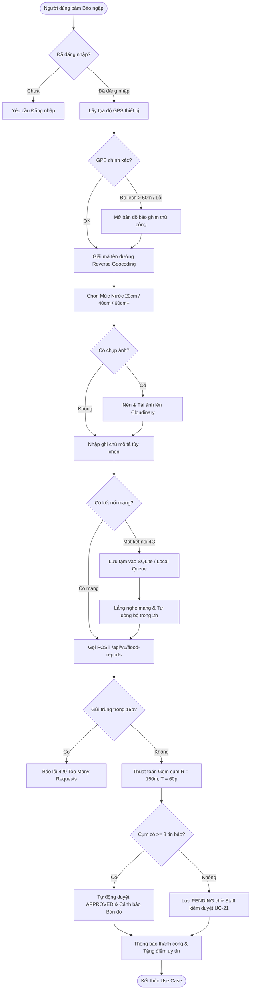

# UC-20: Gửi Báo cáo Điểm ngập Lụt Cộng đồng (Community Flood Report)

**Mã Use Case:** UC-20  
**Tên Use Case:** Gửi Báo cáo Điểm ngập Lụt Cộng đồng (Report Community Flood Incident)  
**Actor chính:** Customer (Khách hàng / Người dân tham gia giao thông)  
**Actor liên quan / Actor phụ:** Field Mechanic (Thợ cứu hộ di chuyển trên đường), Staff (Nhân viên vận hành kiểm duyệt), Spatial Clustering Engine (Thuật toán gom cụm không gian GIS), Cloudinary CDN (Dịch vụ lưu trữ ảnh hiện trường), Firebase Cloud Messaging (FCM Push Service)  
**Phạm vi hệ thống:** Phân hệ Bản đồ & Điểm ngập (`features/floodmap`), Ứng dụng Di động Flutter (`mobile/lib/screens/customer/community_flood_report_screen.dart`), Cổng Quản trị Vận hành Web GIS (`web/src/components/views/GISFloodMapView.tsx`)  
**Độ ưu tiên:** Cao (High)  
**Ngày cập nhật:** 02/11/2026 (Phiên bản chuẩn hóa giải quyết mâu thuẫn mức ngập, thuật toán gom cụm tự động, hàng đợi ngoại tuyến và đồng bộ mã nguồn)  

---

## 1. Mô tả Nghiệp vụ (Business Overview)

Use Case này hiện thực hóa cơ chế **Thu thập dữ liệu từ cộng đồng (Crowdsourcing)**, cho phép người dân và tài xế lưu thông trên đường chủ động cảnh báo các đoạn đường ngập nước do triều cường hoặc mưa bão trong thời gian thực:
- **Tự động định vị không gian:** Tích hợp GPS thiết bị để xác định chính xác tọa độ vĩ độ/kinh độ và tự động điền địa chỉ thông qua cơ chế giải mã địa chỉ ngược (Reverse Geocoding). Đồng thời cung cấp công cụ **Kéo ghim thủ công (Pin Drop Fallback)** khi GPS bị trôi lệch do che khuất bởi cao ốc, cầu vượt hoặc tán cây trong mưa bão.
- **Chuẩn hóa 3 mức độ sâu của nước (`DepthLevel`):** Ánh xạ trực quan với các bộ phận trọng yếu của xe máy nhằm cảnh báo nguy cơ chết máy, hư hỏng động cơ (Mắt cá chân $20\text{ cm}$, Nửa bánh xe $40\text{ cm}$, Ngập yên xe $60\text{ cm}+$ nguy cơ thủy kích tức thì).
- **Đính kèm bằng chứng ảnh hiện trường:** Tải ảnh chụp trực tiếp từ camera hoặc thư viện lên Cloudinary CDN (tối đa 3 ảnh, hỗ trợ nén dung lượng). Ảnh chụp là tùy chọn linh hoạt nhằm bảo đảm an toàn cho người dân đang lái xe dưới mưa gió, nhưng được khuyến khích để tăng Điểm tin cậy (`confidenceScore`).
- **Thuật toán Gom cụm Không gian Tự động (Spatial Clustering Engine):** Tự động rà soát và gom các báo cáo trong **bán kính 150 mét** và trong **cửa sổ thời gian 60 phút** thành một Cụm ngập duy nhất, tự động tính toán số lượt báo cáo đồng thuận (`clusterCount`) và cập nhật điểm tin cậy tổng hợp.
- **Cơ chế Phê duyệt Kép (Dual Verification Mechanism):**
  1. *Tự động kích hoạt (Auto-Cluster Consensus):* Khi một cụm điểm ngập nhận từ **3 báo cáo độc lập** trở lên từ các tài khoản khác nhau trong vòng 60 phút, hệ thống tự động phê duyệt (`status = 'APPROVED'`) và lập tức công khai điểm cảnh báo lên bản đồ số toàn hệ thống mà không cần chờ can thiệp thủ công.
  2. *Kiểm duyệt thủ công (Staff Moderation - UC-21):* Nhân viên vận hành (Staff) giám sát hàng đợi trên Web Dashboard, xem ảnh chụp thực tế và có toàn quyền kích hoạt sớm, điều chỉnh mức nước hoặc loại bỏ tin rác/spam.
- **Hàng đợi Ngoại tuyến và Tự động Đồng bộ (Offline Queue & Auto-Sync):** Trong điều kiện bão lũ gây chập chờn hoặc mất sóng 4G, ứng dụng lưu tạm báo cáo vào bộ nhớ cục bộ thiết bị (Local Cache / SQLite) và tự động đẩy lên máy chủ ngay khi thiết bị khôi phục kết nối Internet (thời gian sống TTL tối đa 2 giờ).
- **Quản lý lịch sử báo cáo cá nhân (`GET /my`):** Người dùng có thể theo dõi trạng thái các điểm ngập mình đã báo cáo (Đang chờ duyệt, Đã duyệt, Đã hết hạn/Nước rút) và nhận điểm thưởng uy tín cộng đồng.

### 1.1. User Stories

* **Là một Người tham gia giao thông (`Customer`):**
  * Tôi muốn mở ứng dụng và chỉ mất dưới 15 giây để gửi thông tin đoạn đường ngập kèm mức nước để bà con đi sau không bị chết máy oan uổng.
  * Tôi muốn có thể chỉnh lại vị trí trên bản đồ nếu GPS điện thoại bị sai lệch khi tôi đang đứng trú mưa dưới mái hiên.
  * Tôi muốn báo cáo được lưu tạm khi điện thoại mất sóng 4G và tự động gửi đi khi bắt được WiFi hoặc sóng điện thoại ổn định trở lại.
* **Là một Nhân viên Vận hành Hệ thống (`Staff`):**
  * Tôi muốn các điểm ngập có nhiều người cùng báo cáo ($\ge 3$ người) tự động kích hoạt cảnh báo đỏ trên bản đồ để cảnh báo kịp thời cho tài xế và thợ cứu hộ.
  * Tôi muốn xem ảnh chụp và thời gian gửi để xác thực điểm ngập và loại bỏ các tin báo khống, tin spam hoặc ghim sai vị trí.
* **Là một Tài xế Xe máy trong vùng ngập:**
  * Tôi muốn nhận được thông báo đẩy sớm khi lộ trình phía trước có điểm ngập sâu lút ống pô hoặc ngập yên xe để kịp thời chuyển hướng đi khác.

---

## 2. Điều kiện Tiên quyết (Pre-conditions)

Để người dùng có thể gửi báo cáo điểm ngập cộng đồng thành công, các điều kiện sau đây phải được thỏa mãn:
- **PRE-1 (Xác thực tài khoản):** Người dùng đã đăng nhập thành công vào ứng dụng di động với tài khoản hợp lệ (`role = 'ROLE_CUSTOMER'` hoặc `role = 'ROLE_FIELD_MECHANIC'`). Hệ thống từ chối yêu cầu gửi báo cáo nặc danh không có JWT token để ngăn chặn tấn công spam và phá hoại dữ liệu giao thông.
- **PRE-2 (Quyền định vị & Phần cứng GPS):** Thiết bị di động đã bật dịch vụ định vị (Location Services) và người dùng đã cấp quyền truy cập vị trí (`ACCESS_FINE_LOCATION` hoặc `ACCESS_COARSE_LOCATION`). Trong trường hợp không có GPS, người dùng bắt buộc phải chọn vị trí thủ công trên bản đồ.
- **PRE-3 (Phạm vi Không gian Hợp lệ - Geofence):** Tọa độ gửi báo cáo phải nằm trong ranh giới địa lý được hỗ trợ bởi hệ thống (Ví dụ: Thành phố Hồ Chí Minh và các tỉnh thành lân cận trong phạm vi vận hành của PRM393).
- **PRE-4 (Giới hạn Tần suất - Rate Limit):** Tài khoản người dùng không vi phạm quy tắc chống spam (không gửi vượt quá 01 báo cáo tại cùng một vị trí trong vòng 15 phút theo quy tắc `BR-MAP-004`).

---

## 3. Điều kiện Sau thực hiện (Post-conditions)

- **POST-1 (Lưu trữ Dữ liệu Báo cáo):** Điểm báo ngập mới được lưu thành công vào cơ sở dữ liệu (bảng `flood_report_points`), gắn liền với định danh người báo cáo (`reported_by_user_id`), thời gian tạo (`created_at`) và các đường dẫn ảnh hiện trường (`image_urls`).
- **POST-2 (Cập nhật Cụm Không gian):** Hệ thống cập nhật số đếm cụm (`cluster_count`) và điểm tin cậy (`confidence_score`). Nếu cụm điểm ngập đã có từ 3 tin báo trở lên trong 60 phút, trạng thái tự động chuyển thành `APPROVED`.
- **POST-3 (Hiển thị Công khai & Dẫn đường):** Nếu điểm ngập ở trạng thái `APPROVED`, điểm ngập lập tức xuất hiện trên bản đồ công cộng (`GET /api/v1/flood-reports/active`), sẵn sàng cho thuật toán điều hướng tránh ngập (UC-22).
- **POST-4 (Kích hoạt Cảnh báo Sớm):** Nếu điểm ngập ở mức nguy hiểm (`SEAT_60CM_PLUS`), hệ thống tự động kích hoạt dịch vụ FCM bắn thông báo đẩy cảnh báo sớm tới các tài xế trong bán kính 1.000m hướng về điểm ngập.
- **POST-5 (Liên kết Gara Ứng trực):** Hệ thống tự động tính toán khoảng cách và hiển thị gợi ý các chi nhánh gara/đội thợ cứu hộ đang trực chiến gần nhất (`nearbyStations`) để hỗ trợ các xe gặp sự cố.

---

## 4. Các Luồng Nghiệp vụ (Use Case Flows)



### 4.0. Danh mục Mức độ sâu Nước ngập Chuẩn hóa (`DepthLevel`)

Nhằm bảo đảm tính đồng bộ dữ liệu tuyệt đối giữa Ứng dụng Mobile Flutter, Backend Spring Boot và Web Vận hành, hệ thống áp dụng danh mục chuẩn hóa 3 mức nước:

| Mã Enum Backend | Nhãn Giao diện | Độ sâu Ước tính | Mức độ Nguy hiểm & Khuyến cáo Xe máy | Màu sắc Bản đồ | Biểu tượng (Icon) |
| :--- | :--- | :--- | :--- | :--- | :--- |
| `ANKLE_20CM` | **Ngập mắt cá chân** | $10\text{ cm} - 25\text{ cm}$ | Nước chưa chạm ống xả. Xe số và xe ga có thể đi chậm qua. Chú ý gợn sóng từ ô tô. | **Màu Vàng** (`#F59E0B`) | `water_drop` (Vàng) |
| `HALF_WHEEL_40CM` | **Ngập nửa bánh xe** | $26\text{ cm} - 45\text{ cm}$ | Nước chạm miệng ống xả và buồng côn xe tay ga. **Nguy cơ chết máy cao**. Xe số cần về số thấp giữ đều ga, xe ga không nên đi vào. | **Màu Cam** (`#F97316`) | `warning` (Cam) |
| `SEAT_60CM_PLUS` | **Ngập yên xe (Sâu)** | $> 45\text{ cm}$ | Nước lút động cơ, lọt vào buồng đốt, nguy cơ **thủy kích cong dập tay biên tức thì**. **CẤM LƯU THÔNG**. Cần dịch vụ chở xe vượt ngập chuyên dụng. | **Màu Đỏ** (`#EF4444`) | `dangerous` (Đỏ) |

---

### 4.1. Luồng chính (Normal Flow) — Gửi Báo cáo Điểm ngập Trực tiếp

1. **Khởi tạo:** Người dùng bấm vào nút hành động nổi (Floating Action Button) **"Báo ngập"** trên thanh điều hướng hoặc màn hình bản đồ chính của ứng dụng Mobile.
2. **Xác định vị trí:**
   - Ứng dụng kích hoạt GPS và lấy tọa độ hiện tại `(latitude, longitude)`.
   - Ứng dụng gọi dịch vụ Reverse Geocoding để chuyển đổi tọa độ thành địa chỉ đường phố hiển thị trực quan (VD: *"148 Trần Xuân Soạn, P. Tân Hưng, Quận 7, TP.HCM"*).
3. **Chọn mức độ sâu của nước:** Người dùng chọn một trong 3 nút trực quan:
   - `[ 20cm - Ngập mắt cá chân ]`
   - `[ 40cm - Ngập nửa bánh xe ]` *(Được chọn mặc định)*
   - `[ 60cm+ - Ngập yên xe nguy hiểm ]`
4. **Đính kèm ảnh hiện trường (Tùy chọn):**
   - Người dùng bấm ô **"Thêm ảnh"** (tối đa 3 ảnh).
   - Ứng dụng mở giao diện Camera để chụp trực tiếp hoặc chọn ảnh từ bộ sưu tập.
   - Ứng dụng tự động nén kích thước ảnh (dung lượng $\le 2\text{ MB}$, định dạng JPEG/PNG) và tải lên Cloudinary qua API `POST /api/v1/upload/image`.
   - Đường dẫn ảnh trả về (`imageUrls`) được hiển thị xem trước trên biểu mẫu.
5. **Nhập ghi chú mô tả (Tùy chọn):** Người dùng nhập mô tả chi tiết nếu cần (VD: *"Đoạn trước cây xăng ngập sâu, nhiều xe máy đã chết máy dắt bộ, có ổ gà lớn bên lề phải"*).
6. **Xác nhận và Gửi:** Người dùng nhấn nút **"Gửi Báo Cáo Điểm Ngập"**.
7. **Xử lý Không gian & Gom cụm (Backend):**
   - Hệ thống xác thực tính hợp lệ của dữ liệu đầu vào và kiểm tra giới hạn tần suất gửi tin (`BR-MAP-004`).
   - Hệ thống quét các điểm ngập trong bán kính **150 mét** phát sinh trong **60 phút** gần nhất:
     - Nếu đã có cụm ngập tồn tại: Tăng chỉ số `cluster_count += 1`, cập nhật mức nước trung bình/cao nhất và bổ sung ảnh vào cụm.
     - Nếu chưa có cụm ngập lân cận: Tạo mới một bản ghi điểm ngập với `cluster_count = 1`.
   - **Đánh giá phê duyệt tự động:**
     - Nếu cụm đạt $\ge 3$ báo cáo từ các tài khoản độc lập: Hệ thống tự động đặt `moderationStatus = 'APPROVED'`, gán `confidenceScore = 3` và lập tức hiển thị công khai trên bản đồ.
     - Nếu chưa đủ 3 báo cáo: Lưu ở trạng thái `moderationStatus = 'PENDING'` để Staff thẩm định tại UC-21.
8. **Hoàn tất & Phản hồi:** Ứng dụng hiển thị thông báo gửi thành công kèm thông điệp cảm ơn sự đóng góp cho cộng đồng giao thông, đồng thời tự động cộng **+10 Điểm uy tín cộng đồng** cho tài khoản.

---

### 4.2. Luồng phụ (Alternative Flows)

#### 4.2.1. Điều chỉnh vị trí ghim thủ công trên Bản đồ (Manual Pin Adjust)
* **Kích hoạt:** Khi GPS của thiết bị báo sai số lớn ($> 50\text{ m}$), thiết bị không lấy được GPS do tầng mây bão dày đặc, hoặc người dùng muốn báo ngập cho một vị trí cách đó vài chục mét mà họ vừa đi qua.
* **Các bước thực hiện:**
  1. Người dùng bấm biểu tượng chiếc ghim vị trí hoặc chọn *"Chỉnh sửa vị trí trên bản đồ"*.
  2. Ứng dụng mở màn hình bản đồ toàn phần với tâm ghim cố định ở giữa màn hình.
  3. Người dùng kéo thả bản đồ đến đúng vị trí đoạn đường ngập thực tế và bấm *"Xác nhận điểm này"*.
  4. Hệ thống cập nhật cặp tọa độ mới `(latitude, longitude)`, kích hoạt lại hàm Reverse Geocoding để cập nhật địa chỉ dạng chữ và quay về biểu mẫu báo cáo.

#### 4.2.2. Hàng đợi ngoại tuyến & Tự động đồng bộ (Offline Queue & Auto-Sync)
* **Kích hoạt:** Khi người dùng gửi báo cáo trong khu vực ngập mất sóng viễn thông hoặc 4G bị gián đoạn.
* **Các bước thực hiện:**
  1. Khi nhấn *"Gửi Báo Cáo Điểm Ngập"*, ứng dụng phát hiện không có kết nối Internet (`ConnectivityResult.none` hoặc API timeout).
  2. Ứng dụng tự động lưu toàn bộ dữ liệu báo cáo (tọa độ GPS, mức ngập, mô tả, mốc thời gian `clientCreatedAt`) và lưu tạm file ảnh vào thư mục bộ nhớ đệm cục bộ thiết bị (`Local Storage / SQLite`).
  3. Ứng dụng thông báo: *"Đã lưu báo cáo vào hàng đợi ngoại tuyến. Hệ thống sẽ tự động đồng bộ ngay khi thiết bị có kết nối Internet."*
  4. Một tiến trình nền (Background Worker / Connectivity Listener) liên tục lắng nghe trạng thái kết nối mạng:
     - Khi có mạng trở lại, tiến trình nền kiểm tra tuổi thọ của báo cáo:
       - Nếu thời gian lưu tạm $\le 2\text{ giờ}$: Tiến trình tự động tải ảnh lên Cloudinary và gọi API `POST /api/v1/flood-reports` để đẩy dữ liệu lên máy chủ.
       - Nếu thời gian lưu tạm $> 2\text{ giờ}$: Báo cáo bị hủy bỏ tự động (`EXPIRED_LOCALLY`) kèm thông báo gửi cho người dùng vì nước có thể đã rút, tránh gây nhiễu dữ liệu bản đồ thời gian thực.

#### 4.2.3. Xem Lịch sử Báo cáo của tôi (`GET /my`)
* **Kích hoạt:** Người dùng muốn kiểm tra danh sách các điểm ngập mình đã từng đóng góp và trạng thái duyệt.
* **Các bước thực hiện:**
  1. Người dùng mở mục **"Lịch sử đóng góp"** trong trang Cá nhân.
  2. Ứng dụng gọi API `GET /api/v1/flood-reports/my`.
  3. Màn hình hiển thị danh sách các báo cáo kèm thẻ trạng thái trực quan:
     - `Đang chờ xác minh` (Màu vàng - `PENDING`): Đang chờ gom thêm cụm hoặc Staff duyệt.
     - `Đã kích hoạt cảnh báo` (Màu xanh lá - `APPROVED`): Báo cáo chính xác và đang hiển thị công khai trên bản đồ.
     - `Đã rút nước / Hết hạn` (Màu xám - `EXPIRED`): Tuyến đường đã thông thoáng trở lại.
     - `Bị từ chối` (Màu đỏ - `REJECTED`): Báo cáo sai lệch hoặc ảnh không đúng thực tế kèm ghi chú phản hồi từ Staff (`moderatorNote`).

#### 4.2.4. Báo cáo "Nước đã rút" từ Cộng đồng (Water Receded Community Feedback)
* **Kích hoạt:** Người dùng đi qua một điểm ngập đang có cờ cảnh báo `APPROVED` trên bản đồ và thấy nước đã cạn hoàn toàn.
* **Các bước thực hiện:**
  1. Người dùng chạm vào điểm ngập trên bản đồ và chọn nút **"Báo cáo nước đã rút"**.
  2. Hệ thống ghi nhận phản hồi giải tỏa. Khi một điểm ngập nhận từ 2 phản hồi "nước đã rút" kèm thời gian sau mưa $\ge 45\text{ phút}$, hệ thống ưu tiên đẩy điểm ngập này lên đầu danh sách thẩm định giải tỏa của Staff hoặc tự động hạ về trạng thái `EXPIRED`.

---

## 5. Các Trường hợp Ngoại lệ & Lỗi biên (Exceptions)

- **5.1.E1 Quyền Vị trí / Camera bị Từ chối (Permission Denied):**
  - Nếu người dùng từ chối cấp quyền GPS, ứng dụng hiển thị thông báo hướng dẫn:
    *"Ứng dụng cần quyền vị trí để tự động định vị điểm ngập. Bạn có thể cấp quyền trong Cài đặt hoặc tự ghim vị trí thủ công trên bản đồ."*
  - Nếu người dùng từ chối cấp quyền Camera khi bấm chụp ảnh, ứng dụng cho phép người dùng gửi báo cáo không kèm ảnh mà không chặn luồng nghiệp vụ.
- **5.2.E2 Tọa độ Nằm ngoài Phạm vi Hệ thống (Out-of-Boundary Geofence):**
  - Nếu tọa độ GPS nằm ngoài khu vực dự án hỗ trợ (ví dụ tọa độ không thuộc TP.HCM hoặc ngoài lãnh thổ Việt Nam), hệ thống chặn gửi và báo lỗi:
    *"Tọa độ báo cáo nằm ngoài khu vực cứu hộ và hỗ trợ ngập lụt của hệ thống PRM393. Vui lòng kiểm tra lại thiết bị định vị!"*
- **5.3.E3 Vi phạm Tần suất Báo cáo / Chống Spam (Rate Limit 429):**
  - Nếu người dùng gửi từ 2 báo cáo trở lên tại cùng một vị trí (trong bán kính 150m) trong khoảng thời gian dưới 15 phút, hệ thống từ chối yêu cầu và trả về lỗi HTTP `429 Too Many Requests`:
    *"Bạn đã gửi báo cáo tại khu vực này cách đây ít phút. Để chống spam, vui lòng đợi 15 phút trước khi cập nhật lại tình hình."*
- **5.4.E4 Phát hiện Vị trí Giả lập (Mock Location / Fake GPS Detected):**
  - Nếu ứng dụng phát hiện thiết bị bật cờ `isMockLocation = true` (dùng phần mềm Fake GPS gian lận), hệ thống từ chối tọa độ tự động và cảnh báo:
    *"Phát hiện vị trí giả lập không hợp lệ. Vui lòng sử dụng định vị GPS thực tế để bảo đảm tính an toàn của bản đồ cứu hộ."*
- **5.5.E5 Lỗi Tải ảnh lên Cloudinary (Upload Failure / Timeout):**
  - Nếu mạng chập chờn dẫn đến tải ảnh lên Cloudinary thất bại sau 3 lần thử lại, hệ thống hiển thị tùy chọn:
    *"Tải ảnh lên máy chủ bị gián đoạn. Bạn có muốn tiếp tục gửi báo cáo chỉ với tọa độ và mức nước để kịp thời cảnh báo người đi đường không?"*
    - Nếu chọn *"Đồng ý"*: Tiếp tục gửi báo cáo không có ảnh (`imageUrls = null`).
    - Nếu chọn *"Thử lại"*: Thực hiện tải lại ảnh.
- **5.6.E6 File Ảnh Không Hợp lệ hoặc Quá Dung lượng:**
  - Nếu ảnh chụp vượt quá dung lượng $10\text{ MB}$ hoặc không thuộc định dạng được chấp nhận (`JPEG`, `PNG`, `WEBP`), ứng dụng tự động nén hoặc yêu cầu chụp lại ảnh khác.
- **5.7.E7 Phiên Đăng nhập Hết hạn (`401 Unauthorized`):**
  - Nếu JWT Token của người dùng hết hạn trong lúc đang tạo báo cáo, ứng dụng lưu tạm dữ liệu form vào bộ nhớ cục bộ, điều hướng sang màn hình đăng nhập nhanh và tự động khôi phục lại form báo cáo sau khi đăng nhập thành công.

---

## 6. Quy tắc Nghiệp vụ Liên quan (Business Rules)

- **BR-MAP-001 — Yêu cầu Dữ liệu Báo cáo Điểm ngập:** Báo cáo điểm ngập bắt buộc phải chứa cặp tọa độ GPS hợp lệ (`latitude`, `longitude`), địa chỉ định danh (`address`) và mức độ sâu của nước (`waterDepthLevel`). Ảnh chụp hiện trường (`imageUrls`) và mô tả (`description`) là trường không bắt buộc nhưng được khuyến khích để tăng độ tin cậy.
- **BR-MAP-002 — Bán kính Gom cụm Không gian 150m & Cửa sổ 60 phút:** Hệ thống áp dụng công thức Haversine để quét và gom toàn bộ các báo cáo phát sinh trong **bán kính 150 mét** và trong **thời gian 60 phút** thành một Cụm ngập GIS duy nhất:
  $$d = 2R \arcsin \left( \sqrt{\sin^2\left(\frac{\Delta \varphi}{2}\right) + \cos(\varphi_1)\cos(\varphi_2)\sin^2\left(\frac{\Delta \lambda}{2}\right)} \right) \le 150\text{ m}$$
- **BR-MAP-003 — Cơ chế Tự động Phê duyệt Điểm ngập (Auto-Cluster Approval):**
  - Mỗi báo cáo đơn lẻ có điểm tin cậy khởi điểm: `confidenceScore = 1`. Nếu có kèm ảnh hợp lệ: `confidenceScore = 2`.
  - Khi một cụm ngập đạt từ **3 báo cáo độc lập trở lên** (`clusterCount >= 3`) trong vòng 60 phút, hệ thống **tự động chuyển trạng thái sang `APPROVED`**, nâng `confidenceScore = 3` và tự động ghi chú `moderatorNote`: *"Tự động xác thực cụm ngập GIS (X tin báo trong bán kính 150m)"*.
- **BR-MAP-004 — Chống Spam Báo cáo:** Mỗi tài khoản người dùng chỉ được gửi tối đa **01 báo cáo tại cùng một vị trí** (trong bán kính 150 mét) trong mỗi khoảng thời gian **15 phút**.
- **BR-MAP-005 — Ánh xạ Chuẩn 3 Mức nước & Màu sắc Cảnh báo:** Hệ thống hiển thị điểm ngập trên bản đồ tương ứng với 3 mã Enum thống nhất:
  - `ANKLE_20CM`: Cảnh báo Vàng (Nước ngập nhẹ $10-25\text{ cm}$, lưu ý giảm tốc độ).
  - `HALF_WHEEL_40CM`: Cảnh báo Cam (Ngập sâu $26-45\text{ cm}$, nguy cơ chết máy ống xả).
  - `SEAT_60CM_PLUS`: Cảnh báo Đỏ (Nguy hiểm $> 45\text{ cm}$, cấm xe máy lưu thông, cảnh báo thủy kích).
- **BR-MAP-006 — Thẩm quyền Phê duyệt & Can thiệp của Staff:** Nhân viên vận hành (`STAFF`) có toàn quyền can thiệp vào vòng đời điểm ngập: kích hoạt sớm điểm ngập chưa đủ cụm, điều chỉnh độ sâu, gán ghi chú hiện trường hoặc từ chối (`REJECTED`) nếu phát hiện tin báo giả mạo.
- **BR-MAP-007 — Tự động Hết hạn Vùng ngập Sau 2 Giờ (Time-To-Live):** Điểm ngập đã kích hoạt (`APPROVED`) sẽ tự động mờ dần và chuyển sang trạng thái hết hạn (`EXPIRED`) nếu sau **2 giờ liên tục** không có thêm bất kỳ báo cáo hoặc xác nhận mới nào từ cộng đồng.
- **BR-MAP-008 — Cảnh báo Sớm Bán kính 1.000m:** Khi một điểm ngập ở mức Đỏ (`SEAT_60CM_PLUS`) được kích hoạt, hệ thống tự động phát tin nhắn thông báo đẩy (FCM Notification) đến tất cả người dùng và tài xế đang di chuyển trong bán kính **1.000 mét** hướng về điểm ngập.
- **BR-MAP-009 — Tránh Vùng ngập Khi Chỉ đường Cứu hộ:** Các điểm ngập đang ở mức Đỏ (`SEAT_60CM_PLUS`) được đánh dấu là chướng ngại vật cấm đi trong thuật toán tìm đường cứu hộ (Routing Engine), ngoại trừ các xe cứu hộ có cấu hình chuyên dụng vượt ngập sâu (`hasCrossingCapability = true`).

---

## 7. Thiết kế Cấu trúc Dữ liệu & API Contracts

### 7.1. Cấu trúc Bảng Cơ sở Dữ liệu (`flood_report_points`)

```sql
CREATE TABLE IF NOT EXISTS flood_report_points (
    id BIGINT PRIMARY KEY AUTO_INCREMENT,
    reported_by_user_id BIGINT NOT NULL,
    latitude DOUBLE NOT NULL,
    longitude DOUBLE NOT NULL,
    address VARCHAR(255) NOT NULL,
    water_depth_level VARCHAR(30) NOT NULL, -- ANKLE_20CM, HALF_WHEEL_40CM, SEAT_60CM_PLUS
    image_urls VARCHAR(1000) NULL,           -- URL ảnh Cloudinary, cách nhau bởi dấu phẩy
    description VARCHAR(500) NULL,
    confidence_score INT NOT NULL DEFAULT 1,
    cluster_count INT NOT NULL DEFAULT 1,
    moderation_status VARCHAR(30) NOT NULL DEFAULT 'PENDING', -- PENDING, APPROVED, EXPIRED, REJECTED
    moderated_by_user_id BIGINT NULL,
    moderator_note VARCHAR(500) NULL,
    nearby_stations VARCHAR(255) NULL,       -- Thông tin các trạm/gara cứu hộ ứng trực gần nhất
    created_at TIMESTAMP NOT NULL DEFAULT CURRENT_TIMESTAMP,
    updated_at TIMESTAMP NOT NULL DEFAULT CURRENT_TIMESTAMP ON UPDATE CURRENT_TIMESTAMP,

    CONSTRAINT fk_flood_reported_by FOREIGN KEY (reported_by_user_id) REFERENCES users(id),
    CONSTRAINT fk_flood_moderated_by FOREIGN KEY (moderated_by_user_id) REFERENCES users(id)
);

-- Chỉ mục không gian và chỉ mục phục vụ truy vấn thời gian thực
CREATE INDEX idx_flood_status_created ON flood_report_points(moderation_status, created_at DESC);
CREATE INDEX idx_flood_user ON flood_report_points(reported_by_user_id, created_at DESC);
CREATE INDEX idx_flood_lat_lng ON flood_report_points(latitude, longitude);
```

---

### 7.2. Đặc tả API Endpoints

| Phương thức | Đường dẫn API | Xác thực (Auth) | Vai trò cho phép | Chức năng nghiệp vụ |
| :--- | :--- | :--- | :--- | :--- |
| `POST` | `/api/v1/flood-reports` | Bearer JWT | `CUSTOMER`, `FIELD_MECHANIC` | Gửi báo cáo điểm ngập cộng đồng mới |
| `GET` | `/api/v1/flood-reports/my` | Bearer JWT | `CUSTOMER`, `FIELD_MECHANIC` | Lấy danh sách điểm ngập do chính người dùng hiện tại đã báo cáo |
| `GET` | `/api/v1/flood-reports/active` | Không (Public) | Mọi người dùng | Lấy danh sách các điểm ngập đang hoạt động (`APPROVED`) trên bản đồ |
| `POST` | `/api/v1/upload/image` | Bearer JWT | Mọi người dùng đã đăng nhập | Tải ảnh hiện trường lên Cloudinary CDN và nhận về URL an toàn |

---

### 7.3. Chi tiết DTO Request & Response

#### 1. Gửi báo cáo ngập (`POST /api/v1/flood-reports`)

* **Request Headers:**
  ```http
  Authorization: Bearer <access_token>
  Content-Type: application/json
  ```

* **Request Body JSON (`CreateFloodReportRequest`):**
  ```json
  {
    "latitude": 10.742300,
    "longitude": 106.702100,
    "address": "Số 148 Trần Xuân Soạn, P. Tân Hưng, Quận 7, TP.HCM",
    "waterDepthLevel": "SEAT_60CM_PLUS",
    "description": "Nước ngập lút ống pô và tràn lên yên xe, dòng nước chảy xiết gần mép sông, nhiều xe chết máy dắt bộ.",
    "imageUrls": "https://res.cloudinary.com/prm393/image/upload/v1/flood_reports/sample_01.jpg"
  }
  ```

* **Response Success JSON (`200 OK` - `ApiResponse<FloodReportResponse>`):**
  ```json
  {
    "success": true,
    "message": "Báo cáo điểm ngập thành công! Hệ thống đang xử lý và kích hoạt cảnh báo.",
    "data": {
      "id": 105,
      "reportedById": 24,
      "reportedByName": "Nguyễn Văn An",
      "latitude": 10.742300,
      "longitude": 106.702100,
      "address": "Số 148 Trần Xuân Soạn, P. Tân Hưng, Quận 7, TP.HCM",
      "waterDepthLevel": "SEAT_60CM_PLUS",
      "imageUrls": "https://res.cloudinary.com/prm393/image/upload/v1/flood_reports/sample_01.jpg",
      "description": "Nước ngập lút ống pô và tràn lên yên xe, dòng nước chảy xiết gần mép sông, nhiều xe chết máy dắt bộ.",
      "confidenceScore": 4,
      "clusterCount": 3,
      "moderationStatus": "APPROVED",
      "moderatedById": null,
      "moderatedByName": null,
      "moderatorNote": "Tự động xác thực cụm ngập GIS (3 tin báo trong bán kính 150m)",
      "nearbyStations": "Gara An Phú (cách 450m), Gara Tân Hưng (cách 800m)",
      "createdAt": "2026-11-02T20:30:00"
    }
  }
  ```

* **Mã lỗi thường gặp:**
  * `400 Bad Request`: Thiếu trường bắt buộc (`latitude`, `longitude`, `address`, `waterDepthLevel`) hoặc giá trị tọa độ nằm ngoài dải hợp lệ.
  * `401 Unauthorized`: Chưa đăng nhập hoặc Access Token không hợp lệ/hết hạn.
  * `429 Too Many Requests`: Gửi báo cáo trùng lặp tại cùng vị trí trong vòng 15 phút (`BR-MAP-004`).

---

## 8. Ma trận Kịch bản Kiểm thử Chấp nhận (Acceptance Test Matrix)

| Mã Kịch bản | Tên Kịch bản Kiểm thử | Điều kiện Đầu vào | Kết quả Mong đợi (Expected Outcome) |
| :--- | :--- | :--- | :--- |
| **TC-UC20-01** | Báo ngập thành công có đầy đủ ảnh và GPS | Tọa độ chuẩn tại Q7, mức `HALF_WHEEL_40CM`, ảnh Cloudinary hợp lệ, chưa có cụm xung quanh. | Tạo điểm ngập thành công, `moderationStatus = 'PENDING'`, `confidenceScore = 2`, `clusterCount = 1`. |
| **TC-UC20-02** | Báo ngập không kèm ảnh trong điều kiện mưa lớn | Bỏ trống `imageUrls`, chọn mức `ANKLE_20CM`. | Báo cáo được tiếp nhận thành công, `imageUrls = null`, `confidenceScore = 1`. |
| **TC-UC20-03** | Tự động phê duyệt cụm ngập ($\ge 3$ báo cáo trong 150m/60p) | 3 người dùng khác nhau liên tiếp gửi báo cáo tại cùng đoạn đường cách nhau $< 150\text{ m}$ trong 30 phút. | Tin báo thứ 3 tự động chuyển `moderationStatus = 'APPROVED'`, ghi chú tự động xác thực cụm, điểm xuất hiện trên `GET /active`. |
| **TC-UC20-04** | Chặn spam báo cáo liên tiếp trong 15 phút | Cùng 1 tài khoản vừa gửi báo cáo lúc 20:00, gửi tiếp báo cáo thứ 2 tại cùng tọa độ lúc 20:05. | Hệ thống từ chối với HTTP 429: *"Bạn đã gửi báo cáo tại khu vực này cách đây ít phút..."*. |
| **TC-UC20-05** | Chỉnh ghim thủ công khi GPS bị trôi lệch | Người dùng bấm mở bản đồ kéo ghim sang con đường bên cạnh và gửi báo cáo. | Hệ thống lưu chính xác tọa độ mới của điểm ghim và cập nhật tên đường tương ứng. |
| **TC-UC20-06** | Hoạt động ngoại tuyến khi mất sóng 4G | Thiết bị ngắt kết nối Internet, bấm gửi báo cáo, sau 10 phút bật lại mạng. | Báo cáo được lưu trong SQLite nội bộ; khi có mạng, ứng dụng tự động upload ảnh và gửi API thành công. |
| **TC-UC20-07** | Xem danh sách báo cáo cá nhân (`/my`) | Người dùng đã gửi 2 báo cáo, mở màn hình Lịch sử đóng góp. | Trả về danh sách chính xác 2 báo cáo kèm trạng thái cập nhật thời gian thực (`PENDING`, `APPROVED`). |
