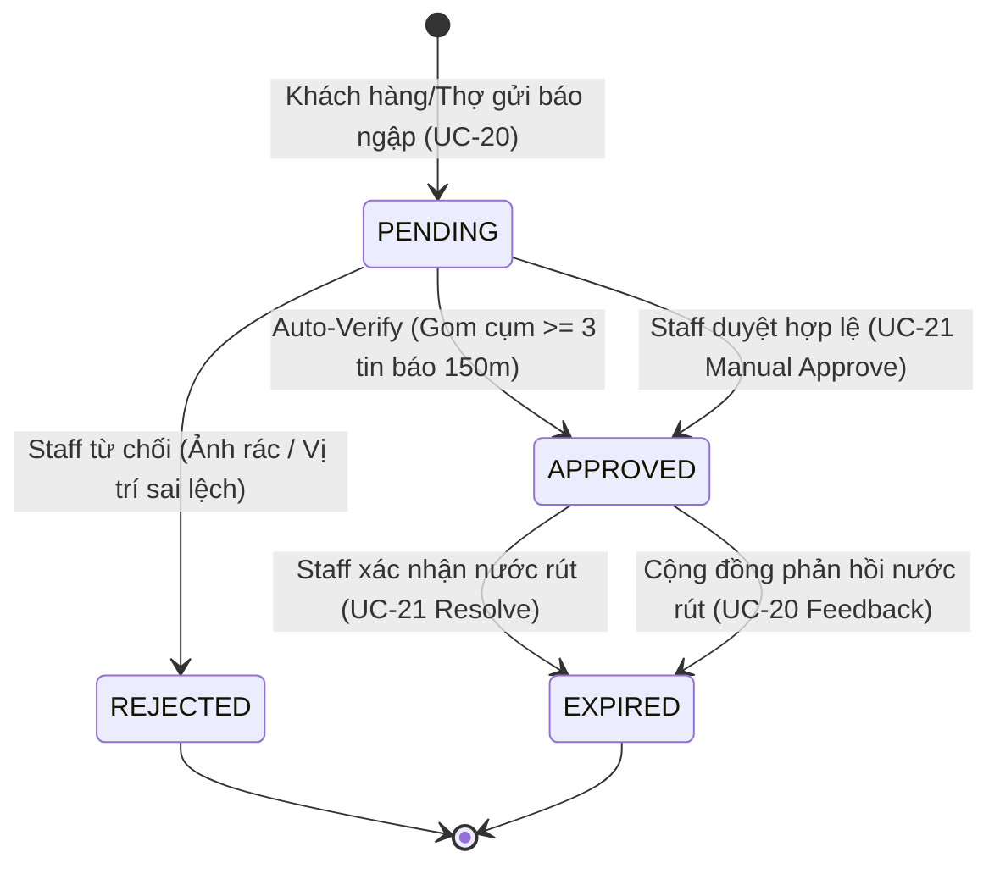

# UC-21: Kiểm duyệt và Xác minh Điểm ngập Lụt (Verify & Moderate Flood Map Points)

**Mã Use Case:** UC-21  
**Tên Use Case:** Kiểm duyệt và Xác minh Điểm ngập Lụt (Verify & Moderate Flood Map Points)  
**Actor chính:** Staff (Nhân viên vận hành hệ thống), Admin (Quản trị viên)  
**Actor phụ / Hệ thống liên quan:** Spatial Clustering Engine (Hệ thống tự động gom cụm GIS), Cloudinary CDN (Dịch vụ lưu trữ ảnh hiện trường), Push Notification Service (Thông báo cứu hộ)  
**Phạm vi hệ thống:** Phân hệ Bản đồ & Điểm ngập (`features/floodmap`), Cổng Quản trị Vận hành Web GIS (`web/src/components/views/GISFloodMapView.tsx`), Backend Spring Boot API (`StaffFloodReportController.java`, `FloodReportService.java`)  
**Độ ưu tiên:** Cao (High)  
**Ngày cập nhật:** 04/11/2026 (Phiên bản chuẩn hóa đối chiếu và đồng bộ mã nguồn)  

---

## 1. Mô tả Nghiệp vụ (Business Overview)

Use Case này cho phép Nhân viên vận hành (Staff) và Quản trị viên (Admin) thẩm định, xác minh độ chính xác và kiểm soát vòng đời của các tin báo ngập lụt được gửi lên từ cộng đồng hoặc thợ cứu hộ (từ `UC-20`). Mục tiêu cốt lõi:
- **Ngăn chặn tin giả và spam:** Loại bỏ các hình ảnh không liên quan, thông tin troll hoặc báo cáo sai lệch tọa độ gây hoang mang cho người tham gia giao thông.
- **Xác thực và kích hoạt cảnh báo thời gian thực:** Điểm ngập sau khi được duyệt (`APPROVED`) sẽ lập tức được công khai trên toàn hệ thống (`UC-22`), xuất hiện trên ứng dụng di động Flutter của người dân và thợ cứu hộ, kích hoạt vòng tròn cảnh báo nguy hiểm.
- **Điều phối nguồn lực cứu hộ:** Cho phép nhân viên vận hành gán thông tin các trạm cứu hộ/chi nhánh gara lân cận (`nearbyStations`) vào điểm ngập để người dân gặp nạn quanh khu vực dễ dàng liên hệ cứu hộ.
- **Cập nhật giải tỏa khi nước rút:** Cho phép Staff xác nhận tuyến đường đã an toàn (`EXPIRED` / `RECEDED`) khi triều cường hạ hoặc mưa ngớt, gỡ cảnh báo khỏi bản đồ giao thông.

### 1.1. User Stories
- **Là một Staff vận hành**, tôi muốn xem danh sách các điểm ngập đang chờ duyệt trên bản đồ vệ tinh/giao thông để dễ dàng đối chiếu vị trí thực địa và tuyến đường giao thông trọng điểm.
- **Là một Staff vận hành**, tôi muốn xem hình ảnh hiện trường kích thước lớn và mức nước được báo cáo để đánh giá chính xác mức độ nguy hiểm đối với xe máy trước khi phát cảnh báo công khai.
- **Là một Staff vận hành**, tôi muốn ghi chú lý do thẩm định và gán trạm cứu hộ phụ trách để thợ cứu hộ và người dân cùng nắm thông tin xử lý.
- **Là một Admin hệ thống**, tôi muốn theo dõi nhật ký kiểm duyệt (Audit Trail) để giám sát các quyết định duyệt/từ chối của nhân viên trong ca trực bão lũ.

---

## 2. Điều kiện Tiên quyết (Pre-conditions)

1. Người dùng đã đăng nhập vào Cổng Quản trị Web (`/admin` hoặc `/staff-portal`) với tài khoản có vai trò `STAFF` hoặc `ADMIN`.
2. Trình duyệt đã gửi kèm Authorization Token hợp lệ (`Bearer <JWT_TOKEN>`) trong Header của mỗi yêu cầu API.
3. Hệ thống cơ sở dữ liệu đã có các bản ghi điểm ngập ở bảng `flood_report_points`.

---

## 3. Điều kiện Sau thực hiện (Post-conditions)

1. Trạng thái của điểm ngập (`moderation_status`) được cập nhật sang một trong các giá trị: `APPROVED`, `REJECTED`, hoặc `EXPIRED`.
2. Hệ thống tự động ghi nhận mã định danh nhân viên duyệt (`moderated_by_user_id`), thời gian cập nhật (`updated_at`), ghi chú thẩm định (`moderator_note`), và thông tin trạm cứu hộ liên quan (`nearby_stations`).
3. Nếu trạng thái là `APPROVED`: Điểm ngập xuất hiện tức thì trong danh sách điểm ngập hoạt động công khai (`GET /api/v1/flood-reports/active`) phục vụ `UC-22`.
4. Hành động kiểm duyệt được ghi nhận vào nhật ký sự kiện kiểm toán (Audit Trail) trên giao diện Web GIS.

---

## 4. Các Luồng Nghiệp vụ (Use Case Flows)



### 4.1. Luồng chính (Normal Flow) — Kiểm duyệt và Phê duyệt Điểm ngập
1. **Truy cập Bản đồ GIS:** Staff mở menu **"Bản đồ ngập & Thẩm định"** trên Web Portal (`GISFloodMapView.tsx`).
2. **Tải dữ liệu:** Giao diện tự động gửi request `GET /api/v1/staff/flood-reports` lấy toàn bộ danh sách điểm ngập.
3. **Hiển thị trực quan:** Bản đồ Leaflet dựng các điểm đánh dấu (Marker), vòng tròn gom cụm 150m và bản đồ nhiệt Heatmap.
4. **Lọc danh sách:** Staff chọn tab bộ lọc **"Chờ duyệt (PENDING)"** để xem các tin báo cần xử lý.
5. **Chọn điểm ngập:** Staff click vào một marker trên bản đồ hoặc click chọn thẻ báo cáo ở danh sách bên phải.
6. **Thẩm định chi tiết:** Hệ thống hiển thị Modal Thẩm định Điểm ngập:
   - Tọa độ GPS (`latitude`, `longitude`), địa chỉ và Quận/Huyện tự động trích xuất.
   - Mức nước ngập: `Mắt cá chân (20cm)`, `Nửa bánh xe (40cm)`, hoặc `Ngập yên xe (60cm+)`.
   - Ảnh chụp hiện trường phóng to kiểm tra mực nước so với bánh xe/vỉa hè.
   - Điểm tin cậy (`confidenceScore`) và số lượng tin báo cùng cụm (`clusterCount`).
   - Tên người báo cáo và thời gian gửi tin.
7. **Nhập thông tin hỗ trợ:**
   - Staff nhập ghi chú thẩm định (`moderatorNote`), ví dụ: *"Ảnh hiện trường xác thực ngập sâu nửa bánh xe đường Huỳnh Tấn Phát."*
   - Staff nhập thông tin trạm cứu hộ gần nhất (`nearbyStations`), ví dụ: *"Gara Tuấn Phát (Cách 1.2km) - Hotline: 0908123456 (2 xe bán tải trực sẵn)."*
8. **Xác nhận Phê duyệt:** Staff bấm nút **"Phê duyệt (APPROVED)"**.
9. **Gửi API:** Web Portal gửi request `PATCH /api/v1/staff/flood-reports/{id}/moderate` kèm body dữ liệu.
10. **Lưu trữ & Phản hồi:** Backend cập nhật `moderation_status = APPROVED`, trả về status 200 OK kèm thông điệp *"Kiểm duyệt điểm ngập thành công!"*.
11. **Cập nhật giao diện:** Thẻ trạng thái trên Web chuyển sang màu xanh lục/cam tương ứng mức ngập, thêm dòng ghi chú vào bảng Audit Log. Điểm ngập ngay lập tức hiển thị công khai trên bản đồ cứu hộ di động `UC-22`.

---

### 4.2. Luồng phụ (Alternative Flows)

#### 4.2.1. Từ chối báo cáo không hợp lệ (`REJECTED`)
- Tại **Bước 7** của Luồng chính, nếu Staff phát hiện:
  - Ảnh hiện trường là ảnh mạng, ảnh chụp phong cảnh không có ngập nước.
  - Vị trí báo cáo sai lệch hoàn toàn so với thực tế hoặc thông tin mô tả mang tính chất spam.
- Staff nhập lý do từ chối vào ô Ghi chú: *"Hình ảnh chụp trong nhà, không thấy ngập đường giao thông."*
- Staff bấm nút **"Từ chối (REJECTED)"**.
- Hệ thống gửi API cập nhật `moderation_status = REJECTED`. Điểm ngập này sẽ bị gạch bỏ, không bao giờ được hiển thị lên bản đồ `UC-22` của người dùng.

#### 4.2.2. Tự động Phê duyệt bằng Spatial Clustering Engine (Auto-Approval)
- Khi có một báo cáo ngập mới gửi vào (`UC-20`), hệ thống tự động quét trong bán kính 150m các tin báo trong vòng 60 phút gần nhất.
- Nếu số lượng tin báo trong cụm đạt $\ge 3$ (`clusterCount >= 3`):
  - Backend tự động chuyển tất cả các điểm ngập trong cụm sang `moderation_status = APPROVED`.
  - Tự động gán `confidenceScore = 5` (Điểm tối đa).
  - Tự động điền ghi chú: *"Tự động xác thực cụm ngập GIS (3 tin báo trong bán kính 150m)"*.
- Khi Staff truy cập Web GIS, điểm ngập này đã ở trạng thái Đã duyệt và có huy hiệu "Đã xác thực tự động".

#### 4.2.3. Xác nhận nước rút và mở đường an toàn (`EXPIRED` / `RECEDED`)
- Khi hết đợt triều cường hoặc nhận được thông báo nước đã rút từ camera giao thông / đội tuần tra / phản hồi cộng đồng:
- Staff mở chi tiết điểm ngập đang hoạt động (`APPROVED`).
- Staff bấm nút **"Nước đã rút (Mở đường an toàn)"**.
- Web Portal gửi request `PATCH /api/v1/staff/flood-reports/{id}/resolve`.
- Backend cập nhật `moderation_status = EXPIRED`, ghi chú *"Đã xác nhận nước rút hoàn toàn, tuyến đường lưu thông an toàn."*.
- Điểm ngập chuyển sang trạng thái an toàn trên bản đồ nội bộ và tự động biến mất khỏi bản đồ cảnh báo công khai của `UC-22`.

---

## 5. Các Trường hợp Ngoại lệ (Exceptions)

- **EX-21.1: Không có quyền truy cập (Unauthorized / Forbidden)**
  - Người dùng chưa đăng nhập hoặc token đã hết hạn -> HTTP 401 Unauthorized.
  - Người dùng có Role là `CUSTOMER` hoặc `FIELD_MECHANIC` cố tình gọi API duyệt -> HTTP 403 Forbidden.
  - Xử lý: Hệ thống từ chối thực hiện, hiển thị thông báo lỗi và điều hướng về trang đăng nhập.
- **EX-21.2: Điểm ngập không tồn tại (Resource Not Found)**
  - ID điểm ngập gửi lên không tồn tại trong cơ sở dữ liệu -> HTTP 404 Not Found.
  - Phản hồi: `{"success": false, "message": "Không tìm thấy điểm báo ngập với id: ..."}`.
- **EX-21.3: Dữ liệu kiểm duyệt không hợp lệ (Bad Request)**
  - Trạng thái gửi lên không thuộc danh sách Enum hợp lệ (`APPROVED`, `REJECTED`, `EXPIRED`) -> HTTP 400 Bad Request.
- **EX-21.4: Lỗi kết nối máy chủ dịch vụ bản đồ (Service Failure)**
  - Lỗi tải tile bản đồ OpenStreetMap hoặc mất kết nối mạng máy trạm -> Hiển thị cảnh báo kết nối và cho phép thao tác duyệt qua danh sách dạng bảng (Fallback View).

---

## 6. Quy tắc Nghiệp vụ Liên quan (Business Rules)

| Mã Quy tắc | Tên Quy tắc | Nội dung chi tiết |
| :--- | :--- | :--- |
| **BR-MAP-001** | **Phân quyền Thẩm định** | Chỉ các tài khoản có Role `STAFF` hoặc `ADMIN` mới được cấp quyền truy cập các endpoint `/api/v1/staff/flood-reports/**` và thực hiện thay đổi trạng thái điểm ngập. |
| **BR-MAP-002** | **Cơ chế Tự động Xác thực Cụm** | Nếu một vị trí có từ 3 tin báo hợp lệ trở lên trong bán kính 150m trong vòng 60 phút, hệ thống tự động duyệt (`APPROVED`) và đẩy `confidenceScore = 5` mà không cần chờ Staff duyệt thủ công. |
| **BR-MAP-003** | **Lưu vết Kiểm duyệt (Audit Trail)** | Mọi thao tác chuyển trạng thái phải lưu lại định danh nhân viên (`moderated_by_user_id`), thời điểm thực hiện (`updated_at`), và nội dung ghi chú (`moderator_note`). |
| **BR-MAP-004** | **Bảo toàn Dữ liệu Lịch sử** | Tuyệt đối không xóa cứng (`Hard Delete`) các bản ghi điểm ngập. Các điểm ngập nước rút được gán trạng thái `EXPIRED` để phục vụ thống kê phân tích ngập úng định kỳ. |
| **BR-MAP-005** | **Đồng bộ Thời gian Thực** | Ngay khi Staff bấm Duyệt hoặc Báo nước rút, bản đồ Web GIS và API Public `GET /active` phải phản ánh dữ liệu mới ngay lập tức. |

---

## 7. Thiết kế Cấu trúc Dữ liệu & API Contracts

### 7.1. Cấu trúc Bảng Cơ sở Dữ liệu (`flood_report_points`)

| Tên Cột | Kiểu Dữ liệu | Ràng buộc | Mô tả |
| :--- | :--- | :--- | :--- |
| `id` | `BIGINT` | PK, Auto Increment | Mã định danh điểm báo ngập |
| `reported_by_user_id` | `BIGINT` | FK -> `users.id`, Not Null | Người gửi tin báo ngập ban đầu |
| `latitude` | `DOUBLE` | Not Null | Tọa độ vĩ độ |
| `longitude` | `DOUBLE` | Not Null | Tọa độ kinh độ |
| `address` | `VARCHAR(255)` | Not Null | Địa chỉ đoạn đường ngập |
| `water_depth_level` | `VARCHAR(30)` | Not Null | Mức ngập (`ANKLE_20CM`, `HALF_WHEEL_40CM`, `SEAT_60CM_PLUS`) |
| `image_urls` | `VARCHAR(1000)`| Nullable | Danh sách URL ảnh hiện trường (Cloudinary) |
| `description` | `VARCHAR(500)` | Nullable | Mô tả chi tiết tình hình ngập |
| `confidenceScore` | `INT` | Default: 1 | Điểm tin cậy (1 đến 5 sao) |
| `clusterCount` | `INT` | Default: 1 | Số lượng tin báo trùng cụm trong bán kính 150m |
| `moderation_status` | `VARCHAR(30)` | Not Null, Default: 'PENDING' | Trạng thái: `PENDING`, `APPROVED`, `EXPIRED`, `REJECTED` |
| `moderated_by_user_id`| `BIGINT` | FK -> `users.id`, Nullable | Nhân viên vận hành/Admin thực hiện duyệt |
| `moderator_note` | `VARCHAR(500)` | Nullable | Ghi chú thẩm định của Staff |
| `nearby_stations` | `VARCHAR(255)` | Nullable | Thông tin trạm cứu hộ/gara phụ trách lân cận |
| `created_at` | `DATETIME` | Not Null | Thời điểm tạo báo cáo |
| `updated_at` | `DATETIME` | Nullable | Thời điểm cập nhật trạng thái gần nhất |

---

### 7.2. Đặc tả API Endpoints

#### 1. Lấy toàn bộ danh sách điểm ngập phục vụ kiểm duyệt
- **Method:** `GET`
- **Endpoint:** `/api/v1/staff/flood-reports`
- **Quyền truy cập:** `STAFF`, `ADMIN` (Bearer Token)
- **Response 200 OK:**
```json
{
  "success": true,
  "message": "Success",
  "data": [
    {
      "id": 12,
      "reportedById": 101,
      "reportedByName": "Lê Hoàng Nam",
      "latitude": 10.7583,
      "longitude": 106.6631,
      "address": "45 Phạm Hùng, Phường 4, Quận 8, TP.HCM",
      "waterDepthLevel": "HALF_WHEEL_40CM",
      "imageUrls": "https://res.cloudinary.com/.../flood_01.jpg",
      "description": "Nước ngập qua nửa bánh xe, nhiều xe số chết máy dắt bộ",
      "confidenceScore": 4,
      "clusterCount": 2,
      "moderationStatus": "PENDING",
      "moderatedById": null,
      "moderatedByName": null,
      "moderatorNote": null,
      "nearbyStations": null,
      "createdAt": "2026-11-04T19:30:00"
    }
  ]
}
```

#### 2. Thẩm định và duyệt điểm ngập (Phê duyệt / Từ chối)
- **Method:** `PATCH`
- **Endpoint:** `/api/v1/staff/flood-reports/{id}/moderate`
- **Quyền truy cập:** `STAFF`, `ADMIN` (Bearer Token)
- **Request Body:**
```json
{
  "status": "APPROVED",
  "moderatorNote": "Đã kiểm tra ảnh hiện trường, ngập nửa bánh xe tại Phạm Hùng Quận 8.",
  "nearbyStations": "Gara Thành Công (Cách 800m) - Hotline: 0912345678"
}
```
- **Response 200 OK:**
```json
{
  "success": true,
  "message": "Kiểm duyệt điểm ngập thành công!",
  "data": {
    "id": 12,
    "moderationStatus": "APPROVED",
    "moderatedById": 5,
    "moderatedByName": "Trần Thị Thu (Staff)",
    "moderatorNote": "Đã kiểm tra ảnh hiện trường, ngập nửa bánh xe tại Phạm Hùng Quận 8.",
    "nearbyStations": "Gara Thành Công (Cách 800m) - Hotline: 0912345678",
    "updatedAt": "2026-11-04T19:35:10"
  }
}
```

#### 3. Xác nhận nước đã rút (Mở đường an toàn)
- **Method:** `PATCH`
- **Endpoint:** `/api/v1/staff/flood-reports/{id}/resolve`
- **Quyền truy cập:** `STAFF`, `ADMIN` (Bearer Token)
- **Response 200 OK:**
```json
{
  "success": true,
  "message": "Đã ghi nhận nước rút, chuyển điểm ngập sang trạng thái an toàn!",
  "data": {
    "id": 12,
    "moderationStatus": "EXPIRED",
    "moderatedById": 5,
    "moderatorNote": "Đã xác nhận nước rút hoàn toàn, tuyến đường lưu thông an toàn."
  }
}
```

---

## 8. Ma trận Kịch bản Kiểm thử Chấp nhận (Acceptance Test Matrix)

| Test ID | Tên Kịch bản Kiểm thử | Dữ liệu Đầu vào (Input) | Kết quả Mong đợi (Expected Output) | Trạng thái Code Test |
| :--- | :--- | :--- | :--- | :---: |
| **TC-21-01** | Staff lấy danh sách điểm ngập chờ kiểm duyệt | Token hợp lệ của `Role: STAFF`, gọi `GET /api/v1/staff/flood-reports` | Trả về HTTP 200 OK, danh sách gồm đầy đủ thông tin tọa độ, ảnh, mức ngập, trạng thái. | ✅ Pass (`FloodReportIntegrationTest`) |
| **TC-21-02** | Khách hàng/Thợ cố tình truy cập API kiểm duyệt | Token của `Role: CUSTOMER` gọi `GET /api/v1/staff/flood-reports` | Bị chặn, trả về HTTP 403 Forbidden theo quy tắc BR-MAP-001. | ✅ Pass (`FloodReportIntegrationTest`) |
| **TC-21-03** | Thẩm định phê duyệt điểm ngập hợp lệ (`APPROVED`) | ID điểm ngập hợp lệ, `status: "APPROVED"`, ghi chú thẩm định | Điểm ngập chuyển sang `APPROVED`, lưu ID staff, trả về HTTP 200 OK. | ✅ Pass (`FloodReportServiceTest`) |
| **TC-21-04** | Từ chối tin báo ngập giả mạo (`REJECTED`) | ID điểm ngập, `status: "REJECTED"`, lý do từ chối | Điểm ngập chuyển sang `REJECTED`, không xuất hiện trên bản đồ công khai. | ✅ Pass (`FloodReportServiceTest`) |
| **TC-21-05** | Xác nhận nước đã rút (`resolveWaterReceded`) | Gọi `PATCH /{id}/resolve` với ID điểm ngập `APPROVED` | Chuyển sang `EXPIRED`, ghi chú an toàn, tự động ẩn khỏi bản đồ cảnh báo. | ✅ Pass (`FloodReportServiceTest`) |
| **TC-21-06** | Kiểm duyệt điểm ngập không tồn tại | Gửi ID = 999999 không có trong DB | Trả về HTTP 404 Not Found kèm `ResourceNotFoundException`. | ✅ Pass (`FloodReportServiceTest`) |
| **TC-21-07** | Tự động phê duyệt cụm ngập $\ge 3$ tin báo | Gửi 3 tin báo liên tiếp trong bán kính 150m | Điểm ngập tự động chuyển `APPROVED`, `confidenceScore = 5` (BR-MAP-002). | ✅ Pass (`FloodReportServiceTest`) |
