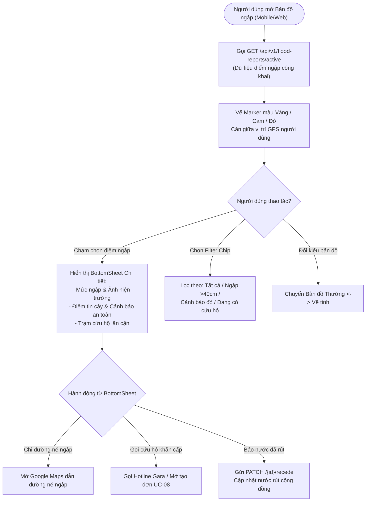

# UC-22: Xem Bản đồ Vùng ngập và Cảnh báo (View Flood Warning Heatmap & Alerts)

**Mã Use Case:** UC-22  
**Tên Use Case:** Xem Bản đồ Vùng ngập và Cảnh báo (View Flood Warning Heatmap & Alerts)  
**Actor chính:** Customer (Khách hàng / Người tham gia giao thông trên đường)  
**Actor phụ / Hệ thống liên quan:** Field Mechanic (Thợ cứu hộ di chuyển ứng cứu), Garage Owner (Chủ gara theo dõi khu vực), Public Guest (Người dùng vãng lai chưa đăng nhập), OpenStreetMap / Mapbox Tiles (Nhà cung cấp bản đồ số), GPS Geolocator Service (Dịch vụ định vị vệ tinh thiết bị)  
**Phạm vi hệ thống:** Phân hệ Bản đồ & Điểm ngập (`features/floodmap`), Ứng dụng Di động Flutter (`mobile/lib/screens/customer/flood_map_screen.dart`), Web GIS Portal (`web/src/components/views/GISFloodMapView.tsx`), Backend Spring Boot API (`FloodReportController.java`, `FloodReportService.java`)  
**Độ ưu tiên:** Cao (High)  
**Ngày cập nhật:** 04/11/2026 (Phiên bản chuẩn hóa đối chiếu và đồng bộ mã nguồn)  

---

## 1. Mô tả Nghiệp vụ (Business Overview)

Use Case này cung cấp cho người tham gia giao thông và các đội thợ cứu hộ một **Bản đồ số cảnh báo ngập lụt tương tác thời gian thực (Real-time Interactive Flood Map)** nhằm giảm thiểu tối đa rủi ro chết máy, ngập bình xăng, thủy kích động cơ và ùn tắc giao thông trong mùa mưa bão và triều cường:
- **Công khai và tiếp cận tức thì:** Mọi người dân đều có thể mở bản đồ xem cảnh báo ngay cả khi chưa đăng nhập tài khoản.
- **Phân loại trực quan mức nguy hiểm xe máy:** Hiển thị trực quan theo 3 màu cảnh báo tiêu chuẩn tương ứng với độ sâu ngập nước so với kết cấu xe máy (Mắt cá chân 20cm - Nửa bánh xe 40cm - Ngập yên xe 60cm+).
- **Bộ lọc thông minh (Smart Filtering):** Cho phép người lái xe lọc nhanh các điểm ngập sâu có nguy cơ chết máy cao (`> 40cm`), các điểm báo động đỏ hoặc các điểm ngập đang có trạm xe bán tải cứu hộ túc trực.
- **Hỗ trợ điều hướng né ngập:** Tích hợp liên kết mở Google Maps để người dùng lập tức tìm lộ trình tránh đoạn ngập nguy hiểm.
- **Tương tác 2 chiều với cộng đồng:** Cho phép người dân trực tiếp bấm nút "Báo nước đã rút" khi đi qua tuyến đường đã rút cạn, giúp dữ liệu bản đồ luôn chính xác và cập nhật theo từng phút.
- **Cầu nối dịch vụ cứu hộ khẩn cấp:** Từ điểm ngập trên bản đồ, khách hàng bị kẹt xe có thể bấm gọi cứu hộ hoặc chuyển tiếp thẳng sang luồng tạo đơn cứu hộ chuyên dụng (`UC-08` / `UC-09`).

### 1.1. User Stories
- **Là một người lái xe máy**, tôi muốn xem bản đồ các điểm ngập trên lộ trình chuẩn bị di chuyển để chủ động chọn tuyến đường khác tránh bị chết máy.
- **Là một người lái xe máy**, tôi muốn biết độ sâu chính xác của đoạn ngập (đến mắt cá, nửa bánh xe hay ngập yên) kèm ảnh chụp thực tế để quyết định có thể đi qua được hay không.
- **Là một tài xế bị kẹt giữa điểm ngập**, tôi muốn bấm một chạm để gọi ngay gara cứu hộ gần nhất hoặc điều xe bán tải chở xe qua điểm ngập.
- **Là một thợ cứu hộ cơ động**, tôi muốn xem bản đồ các điểm ngập nguy cấp đang có nhiều xe chết máy để chủ động di chuyển đến ứng cứu.

---

## 2. Điều kiện Tiên quyết (Pre-conditions)

1. Thiết bị di động hoặc máy tính có kết nối mạng Internet (Wi-Fi, 4G/5G).
2. Người dùng cấp quyền truy cập dịch vụ định vị GPS (Khuyến nghị để bản đồ tự động căn chỉnh vị trí của người dùng; nếu từ chối, hệ thống sử dụng tọa độ trung tâm mặc định TP.HCM).

---

## 3. Điều kiện Sau thực hiện (Post-conditions)

1. Người dùng nắm bắt được toàn bộ các điểm ngập đang hoạt động (`APPROVED`) trong khu vực.
2. Người dùng xem được chi tiết mức ngập, ảnh hiện trường, trạm cứu hộ phụ trách và hướng dẫn né ngập.
3. Nếu người dùng gửi phản hồi "Báo nước đã rút", bản ghi được cập nhật trạng thái `EXPIRED` và gỡ khỏi bản đồ công khai.

---

## 4. Các Luồng Nghiệp vụ (Use Case Flows)



### 4.1. Luồng chính (Normal Flow) — Xem Bản đồ Cảnh báo Ngập trên Mobile
1. **Mở Bản đồ:** Người dùng chọn tab **"Bản đồ ngập"** trên ứng dụng di động Flutter (`FloodMapScreen.dart`).
2. **Tải dữ liệu điểm ngập:** Ứng dụng gửi yêu cầu `GET /api/v1/flood-reports/active` lên máy chủ.
3. **Định vị GPS:** Ứng dụng kích hoạt `Geolocator` để lấy tọa độ hiện tại của người dùng.
4. **Dựng bản đồ trực quan:**
   - Flutter Map hiển thị lớp bản đồ nền OpenStreetMap.
   - Định vị vị trí người dùng bằng icon màu xanh dương kèm vòng tròn chỉ hướng.
   - Dựng các điểm cảnh báo ngập dạng Marker với màu sắc chuẩn hóa:
     - 🟡 **Màu Vàng:** Mắt cá chân $\sim 20\text{ cm}$ (`ANKLE_20CM`).
     - 🟠 **Màu Cam:** Nửa bánh xe $\sim 40\text{ cm}$ (`HALF_WHEEL_40CM`).
     - 🔴 **Màu Đỏ:** Ngập yên xe $\ge 60\text{ cm}$ (`SEAT_60CM_PLUS`).
5. **Chọn xem điểm ngập:** Người dùng chạm vào một Marker cảnh báo trên màn hình.
6. **Hiển thị thông tin chi tiết:** Bản đồ phóng nhẹ vào tâm điểm ngập, đồng thời trượt lên **Bảng chi tiết (BottomSheet)** bao gồm:
   - Tên tuyến đường và Quận/Huyện.
   - Thẻ huy hiệu mức độ cảnh báo (Ví dụ: *"CẢNH BÁO ĐỎ - Ngập sâu yên xe >60cm. Cực kỳ nguy hiểm, nguy cơ thủy kích!"*).
   - Thời gian báo cáo tương đối (*"10 phút trước"*).
   - Điểm tin cậy cộng đồng (1 - 5 sao) và số lượng người cùng gửi tin báo (`clusterCount`).
   - Băng chuyền ảnh chụp hiện trường thực tế (vuốt ngang xem nhiều ảnh phóng to).
   - Thông tin trạm cứu hộ túc trực: Tên gara, hotline và khoảng cách từ gara đến điểm ngập.
7. **Thực hiện điều hướng / cứu hộ:** Người dùng tham khảo thông tin để chủ động né tránh hoặc chọn dịch vụ cứu hộ phù hợp.

---

### 4.2. Luồng phụ (Alternative Flows)

#### 4.2.1. Lọc điểm ngập theo Filter Chips thông minh
- Trên thanh công cụ đỉnh màn hình, người dùng chạm chọn một trong các tiêu chí lọc:
  - **Tất cả (Mặc định):** Hiển thị toàn bộ các điểm ngập đang hoạt động.
  - **Ngập sâu > 40cm:** Ẩn các điểm ngập mắt cá chân 20cm, chỉ tập trung vào các đoạn ngập có nguy cơ làm chết máy xe ga và xe số.
  - **Cảnh báo đỏ:** Chỉ giữ lại các điểm ngập yên xe $\ge 60\text{ cm}$ đặc biệt nguy hiểm.
  - **Đang có cứu hộ:** Chỉ hiển thị các điểm ngập đã được hệ thống liên kết trạm cứu hộ/xe bán tải túc trực lân cận.
- Bản đồ tự động cập nhật lại danh sách Marker hiển thị tức thì theo bộ lọc được chọn.

#### 4.2.2. Chuyển đổi lớp bản đồ nền sang Bản đồ Vệ tinh (Satellite View)
- Người dùng chạm vào nút chuyển đổi lớp bản đồ ở góc phải.
- Bản đồ chuyển từ `OpenStreetMap Standard` sang `Esri World Imagery` (Vệ tinh).
- Giúp người dùng quan sát rõ địa hình thực tế, các con hẻm nhánh, dải phân cách và vùng trũng của khu vực xung quanh điểm ngập.

#### 4.2.3. Chỉ đường né ngập qua liên kết ngoài (Avoid Flood Navigation)
- Tại BottomSheet chi tiết điểm ngập, người dùng chạm nút **"Chỉ đường né ngập"**.
- Ứng dụng chuẩn bị tọa độ điểm đến và gọi `url_launcher` mở ứng dụng Google Maps bên ngoài với tùy chọn tìm kiếm lộ trình vòng tránh điểm ngập hiện tại.

#### 4.2.4. Phản hồi nước đã rút từ cộng đồng (Water Receded Feedback)
- Người dùng khi đi qua vị trí thấy nước đã rút cạn, giao thông đã trở lại bình thường.
- Tại BottomSheet chi tiết, người dùng chạm nút **"Báo nước đã rút"**.
- Ứng dụng gửi request `PATCH /api/v1/flood-reports/{id}/recede` kèm xác thực token.
- Backend ghi nhận cập nhật `moderation_status = EXPIRED` kèm ghi chú *"Cộng đồng báo nước đã rút"*. Điểm ngập lập tức được gỡ bỏ khỏi bản đồ, giúp cộng đồng nhận được thông tin giao thông chính xác nhất.

#### 4.2.5. Phím tắt gửi tin báo ngập mới (`UC-20`)
- Người dùng đang quan sát bản đồ, phát hiện thêm một điểm ngập mới chưa có trên hệ thống.
- Chạm vào nút nổi **"Báo điểm ngập mới (+)"** ở góc phải dưới màn hình.
- Ứng dụng điều hướng ngay sang màn hình `CommunityFloodReportScreen` (`UC-20`) với tọa độ GPS hiện tại được điền sẵn.

---

## 5. Các Trường hợp Ngoại lệ (Exceptions)

- **EX-22.1: Mất kết nối Internet (No Network Connection)**
  - Thiết bị không có kết nối mạng khi tải bản đồ.
  - Xử lý: Bản đồ hiển thị banner thông báo *"Không có kết nối mạng. Đang hiển thị bản đồ từ bộ nhớ đệm (Cache)"* kèm nút **"Thử lại"**.
- **EX-22.2: Người dùng từ chối quyền truy cập GPS (Location Permission Denied)**
  - Người dùng không cấp quyền định vị vị trí cho ứng dụng.
  - Xử lý: Ứng dụng không báo lỗi dừng màn hình mà tự động căn giữa bản đồ về tọa độ trung tâm TP. Hồ Chí Minh (`10.7769, 106.7009`), đồng thời hiển thị nút nhỏ nhắc cấp quyền nếu muốn tự động tìm vị trí của mình.
- **EX-22.3: Không có điểm ngập nào đang hoạt động (Empty Flood List)**
  - Trong mùa khô hoặc thời tiết thuận lợi, danh sách trả về rỗng (`data: []`).
  - Xử lý: Bản đồ hiển thị bình thường kèm huy hiệu thông báo màu xanh lá cây: *"Thời tiết thuận lợi - Tuyến đường thông thoáng, không có cảnh báo ngập trong khu vực"*.

---

## 6. Quy tắc Nghiệp vụ Liên quan (Business Rules)

| Mã Quy tắc | Tên Quy tắc | Nội dung chi tiết |
| :--- | :--- | :--- |
| **BR-MAP-006** | **Dữ liệu Bản đồ Công khai (Public Access)** | Endpoint lấy danh sách điểm ngập hoạt động `GET /api/v1/flood-reports/active` là tài nguyên công khai (Public), không yêu cầu Header Authorization (JWT) để mọi người dân có thể tra cứu tức thì khi khẩn cấp. |
| **BR-MAP-007** | **Quy tắc Bộ lọc Trạng thái Hiển thị** | Chỉ các điểm ngập có trạng thái `moderation_status = 'APPROVED'` mới được phép trả về trên bản đồ công khai UC-22. Mọi điểm ngập ở trạng thái `PENDING` (chưa duyệt), `REJECTED` (từ chối), hoặc `EXPIRED` (đã rút) tuyệt đối không được hiển thị cho người dân. |
| **BR-MAP-008** | **Chuẩn hóa Màu sắc & Biểu tượng Cảnh báo** | Toàn bộ các nền tảng (Flutter Mobile và React Web) phải thống nhất bảng màu: Mức 20cm (Vàng `#F59E0B`), Mức 40cm (Cam `#F97316`), Mức 60cm+ (Đỏ `#EF4444`). |
| **BR-MAP-009** | **Cập nhật Vùng ngập An toàn Tức thì** | Khi điểm ngập được xác nhận nước rút (bởi Staff `UC-21` hoặc bởi cộng đồng `UC-20`), điểm ngập phải ngay lập tức bị loại khỏi phản hồi `GET /active` ở lần truy vấn kế tiếp. |

---

## 7. Thiết kế Cấu trúc Dữ liệu & API Contracts

### 7.1. Đặc tả API Endpoints

#### 1. Lấy danh sách các điểm ngập đang hoạt động (Public Map Points)
- **Method:** `GET`
- **Endpoint:** `/api/v1/flood-reports/active`
- **Quyền truy cập:** Công khai (`Public` - Không cần Token)
- **Response 200 OK:**
```json
{
  "success": true,
  "message": "Success",
  "data": [
    {
      "id": 8,
      "reportedById": 102,
      "reportedByName": "Nguyễn Văn Hùng",
      "latitude": 10.7325,
      "longitude": 106.7214,
      "address": "Đường Huỳnh Tấn Phát, Phường Tân Phú, Quận 7, TP.HCM",
      "waterDepthLevel": "SEAT_60CM_PLUS",
      "imageUrls": "https://res.cloudinary.com/.../flood_q7.jpg",
      "description": "Ngập sâu quá yên xe, nước dâng nhanh do triều cường, nhiều xe chết máy",
      "confidenceScore": 5,
      "clusterCount": 4,
      "moderationStatus": "APPROVED",
      "moderatedById": 5,
      "moderatedByName": "Trần Thị Thu (Staff)",
      "moderatorNote": "Đã xác thực triều cường ngập sâu, cảnh báo đỏ",
      "nearbyStations": "Gara Cứu Hộ Nam Sài Gòn (Cách 500m) - Hotline: 0988776655",
      "createdAt": "2026-11-04T18:45:00"
    },
    {
      "id": 9,
      "reportedById": 103,
      "reportedByName": "Trần Tuấn Anh",
      "latitude": 10.7583,
      "longitude": 106.6631,
      "address": "45 Phạm Hùng, Phường 4, Quận 8, TP.HCM",
      "waterDepthLevel": "HALF_WHEEL_40CM",
      "imageUrls": "https://res.cloudinary.com/.../flood_q8.jpg",
      "description": "Nước ngập nửa bánh xe",
      "confidenceScore": 4,
      "clusterCount": 2,
      "moderationStatus": "APPROVED",
      "moderatedById": 5,
      "moderatedByName": "Trần Thị Thu (Staff)",
      "moderatorNote": "Đã duyệt",
      "nearbyStations": "Gara Thành Công (Cách 800m) - Hotline: 0912345678",
      "createdAt": "2026-11-04T19:00:00"
    }
  ]
}
```

#### 2. Cộng đồng phản hồi nước đã rút tại điểm ngập
- **Method:** `PATCH`
- **Endpoint:** `/api/v1/flood-reports/{id}/recede`
- **Quyền truy cập:** Khách hàng đã đăng nhập (`Role: CUSTOMER`, `FIELD_MECHANIC` - Bearer Token)
- **Response 200 OK:**
```json
{
  "success": true,
  "message": "Đã ghi nhận báo cáo nước rút! Cảm ơn bạn đã đóng góp cho cộng đồng.",
  "data": {
    "id": 9,
    "moderationStatus": "EXPIRED",
    "moderatorNote": "Cộng đồng báo nước đã rút (Xác nhận bởi Lê Hoàng Nam). Tuyến đường đã lưu thông an toàn."
  }
}
```

---

## 8. Ma trận Kịch bản Kiểm thử Chấp nhận (Acceptance Test Matrix)

| Test ID | Tên Kịch bản Kiểm thử | Dữ liệu Đầu vào (Input) | Kết quả Mong đợi (Expected Output) | Trạng thái Code Test |
| :--- | :--- | :--- | :--- | :---: |
| **TC-22-01** | Khách truy cập lấy danh sách điểm ngập công khai | Gọi `GET /api/v1/flood-reports/active` không gửi kèm Authorization Header | Trả về HTTP 200 OK, chỉ gồm các điểm có `moderation_status = APPROVED` (BR-MAP-006, BR-MAP-007). | ✅ Pass (`FloodReportIntegrationTest`) |
| **TC-22-02** | Điểm ngập `PENDING` và `REJECTED` bị ẩn trên bản đồ | Tạo 1 điểm `PENDING` và 1 điểm `REJECTED`, gọi `GET /active` | Danh sách trả về không chứa 2 điểm ngập trên. | ✅ Pass (`FloodReportServiceTest`) |
| **TC-22-03** | Lọc theo độ sâu ngập trên ứng dụng Mobile | Chọn Chip "Ngập sâu > 40cm" trên màn hình Flutter | Danh sách hiển thị trên bản đồ chỉ còn các điểm `HALF_WHEEL_40CM` và `SEAT_60CM_PLUS`. | ✅ Pass (`flood_map_screen.dart`) |
| **TC-22-04** | Chuyển đổi lớp bản đồ vệ tinh | Nhấn icon Satellite trên `FloodMapScreen` | Bản đồ tải lớp gạch ngói vệ tinh mượt mà, giữ nguyên các Marker cảnh báo. | ✅ Pass (`flood_map_screen.dart`) |
| **TC-22-05** | Xem BottomSheet chi tiết điểm ngập | Chạm vào Marker trên bản đồ di động | BottomSheet hiện đầy đủ mức nước, địa chỉ, ảnh phóng to, trạm cứu hộ và nút né ngập. | ✅ Pass (`flood_map_screen.dart`) |
| **TC-22-06** | Báo nước đã rút từ người dùng cộng đồng | Token hợp lệ của Customer gọi `PATCH /{id}/recede` | Điểm ngập chuyển trạng thái `EXPIRED`, ghi chú an toàn, lập tức biến mất khỏi bản đồ `/active`. | ✅ Pass (`FloodReportIntegrationTest`) |
| **TC-22-07** | Báo nước rút cho điểm ngập không tồn tại | Gửi ID = 999999 không có trong DB | Trả về HTTP 404 Not Found kèm thông báo lỗi thân thiện. | ✅ Pass (`FloodReportServiceTest`) |
