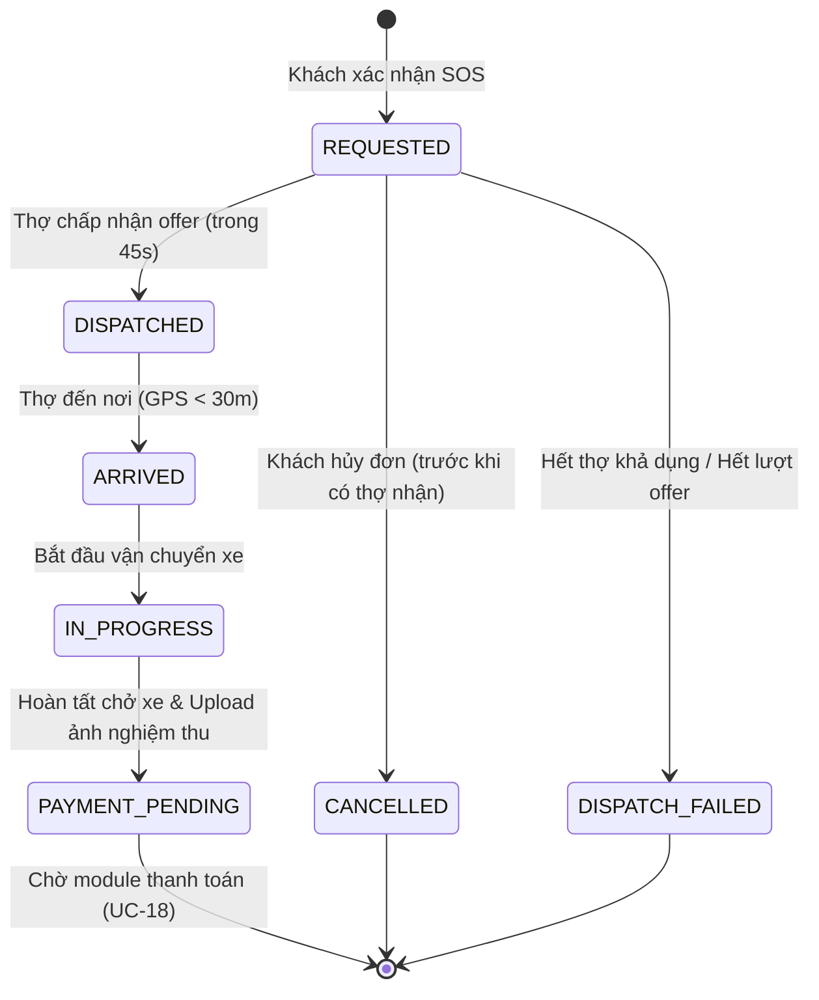

# QUYẾT ĐỊNH THIẾT KẾ & ĐẶC TẢ NGHIỆP VỤ: LUỒNG CHỞ XE VƯỢT NGẬP ĐƠN LẺ (SINGLE CROSSING)
**Dự án:** Motorbike Flood Rescue Platform (PRM393)  
**Phụ trách tích hợp Luồng 3:** Lê Chí Nhân  
**Các Use Case tích hợp:** UC-08, UC-10, UC-11, UC-12, UC-15, UC-17 (kèm giao diện tĩnh/contract cho UC-18 và UC-19)

---

## 1. Bối cảnh và Quyết định Thiết kế Bổ sung

Để giải quyết các khoảng trống trong tài liệu đặc tả (SRS) và các tài liệu sơ đồ hệ thống, nhóm thống nhất các quyết định thiết kế bổ sung như sau:

### 1.1. Giữ giá nhất quán trong một Gara đã chọn
- **Khoảng trống trong SRS:** SRS chưa chốt cách giữ giá khi một đơn hàng được điều phối tự động qua nhiều gara khác nhau có mức giá niêm yết khác nhau.
- **Quyết định thiết kế:**
  1. Khi khách hàng chuẩn bị gửi yêu cầu SOS chở xe vượt ngập đơn lẻ, ứng dụng gọi backend lấy danh sách các Gara đủ điều kiện (đã phê duyệt, có chi nhánh đang mở, có dịch vụ `ServiceType.CROSSING` đang kích hoạt `active = true`, và có ít nhất một thợ có khả năng chở xe trực tuyến).
  2. Khách hàng xem giá niêm yết của dịch vụ chở xe của gara (`serviceBasePrice`) cùng phí điều phối (`bookingFee`), và bấm xác nhận chọn gara đó.
  3. Khi tạo đơn, backend lưu snapshot thông tin dịch vụ, bảng giá và khóa đơn hàng vào gara đã chọn.
  4. Quá trình điều phối tuần tự các thợ chỉ tìm kiếm trong số các thợ thuộc gara này.
  5. Nếu không còn thợ nào thuộc gara này nhận đơn (sau các vòng offer hoặc hết thợ), hệ thống kết thúc tìm kiếm với trạng thái `DISPATCH_FAILED`, hiển thị số hotline tổng đài hỗ trợ và cho phép khách hàng chọn gara khác nếu muốn, tuyệt đối không tự ý chuyển sang gara khác làm thay đổi mức giá đã báo trước cho khách.

### 1.2. Điểm đón (Pickup) và Điểm trả xe tại nơi khô ráo (Dropoff)
- **Khoảng trống trong SRS:** Bảng `rescue_orders` trong đặc tả cũ chỉ lưu `latitude` và `longitude` của điểm đón ngập lụt, trong khi diagram luồng chở xe có tọa độ đích đến. Không thể mặc định chở xe là kéo về gara.
- **Quyết định thiết kế:**
  1. Đơn hàng chở xe đơn lẻ (`SINGLE_CROSSING`) bắt buộc lưu cả hai cặp tọa độ và địa chỉ:
     - Điểm đón: `pickupAddress`, `pickupLatitude`, `pickupLongitude` (nơi xe đang kẹt tại điểm ngập).
     - Điểm trả: `dropoffAddress`, `dropoffLatitude`, `dropoffLongitude` (nơi khô ráo an toàn bên kia điểm ngập do khách chỉ định).
  2. Không ép buộc kéo xe về gara trừ khi khách chọn nhánh cứu hộ ngập lụt sửa chữa (nhánh 2B - ngoài phạm vi luồng này).

### 1.3. Tính toán Giá và Phí điều phối (Booking Fee)
- **Quy tắc tính toán:**
  $$\text{totalAmount} = \text{serviceBasePrice} + \text{bookingFee}$$
- **Quyết định thiết kế:**
  1. `serviceBasePrice` lấy từ `garage_service_catalog.standard_price` của dịch vụ `CROSSING` thuộc gara được chọn.
  2. `bookingFee` lấy từ cấu hình server riêng (`app.rescue.booking-fee`, mặc định môi trường dev: `30,000 VND`). Trường này không tồn tại trong catalog dịch vụ vì đây là phụ phí dịch vụ nền tảng do sàn quy định.
  3. Giá trị tiền tệ sử dụng kiểu `BigDecimal` với quy ước đơn vị `VND`.
  4. Backend hoàn toàn tự tính và lưu snapshot giá vào `rescue_orders`, không tin cậy bất kỳ giá tiền nào do client gửi lên.
  5. Nếu giá niêm yết của gara thay đổi giữa lúc khách xem và lúc bấm xác nhận tạo đơn, server kiểm tra và yêu cầu khách xác nhận lại mức giá mới. Thay đổi bảng giá sau khi đơn đã tạo không làm ảnh hưởng đến đơn cũ.

### 1.4. Bán kính và Thời gian Điều phối Tuần tự (UC-10)
- **Quy tắc điều phối:**
  1. Hệ thống tìm kiếm các thợ thỏa mãn tất cả tiêu chí:
     - Gara thuộc trạng thái `APPROVED`.
     - Chi nhánh thuộc trạng thái `OPEN`.
     - Tài khoản thợ `active = true`.
     - Trạng thái làm việc `MechanicStatus.AVAILABLE`.
     - Thợ có năng lực phương tiện chở xe máy: `hasCrossingCapability = true`.
     - Vị trí GPS / heartbeat còn mới: cập nhật trong vòng `app.rescue.heartbeat-valid-minutes` (mặc định 5 phút).
  2. Bán kính điều phối: Bắt đầu quét trong bán kính mặc định 5 km, mở rộng tối đa 7 km (cụ thể hóa khoảng 3–5 km trong SRS).
  3. Các ứng viên được sắp xếp tăng dần theo khoảng cách địa lý tới điểm đón của khách.
  4. Hệ thống gửi offer lần lượt cho từng thợ (tuần tự), mỗi offer có hạn chính xác 45 giây do server ấn định (`expiresAt = now + 45s`).
  5. Nếu thợ từ chối (`REJECTED`) hoặc hết 45 giây không phản hồi (`EXPIRED`), hệ thống tự động gửi offer cho thợ tiếp theo.
  6. Toàn bộ offers và hạn chót được lưu trong cơ sở dữ liệu (`rescue_offers`), cho phép phục hồi và tiếp tục đếm ngược sau khi server khởi động lại.

### 1.5. Nhận đơn Nguyên tử và Quản lý Trạng thái Thợ
- **Nguyên tắc nhận đơn:**
  1. Một đơn cứu hộ chỉ được giao cho duy nhất 1 thợ.
  2. Một thợ chỉ được nhận tối đa 1 đơn cứu hộ đang hoạt động.
  3. Thao tác nhận đơn được thực hiện trong giao dịch cô lập cao với khóa bi quan (Pessimistic Lock). Khi nhận thành công:
     - Đơn chuyển sang `DISPATCHED`.
     - Thợ chuyển sang `MechanicStatus.BUSY`.
  4. Endpoint chuyển trạng thái thợ (`toggleStatus`) chặn tuyệt đối việc thợ/khách tự ý gán `BUSY` hoặc tự chuyển sang `AVAILABLE`/`OFFLINE` khi đang có đơn cứu hộ hoạt động.
  5. Chặn việc điều chuyển chi nhánh (`allocateBranch`) cho thợ đang xử lý đơn cứu hộ.

### 1.6. Khách hàng Hủy đơn
- Khách hàng được quyền hủy đơn miễn phí khi đơn còn ở trạng thái `REQUESTED` (chưa có thợ nào nhận).
- Sau khi thợ đã nhận (`DISPATCHED` trở đi), hệ thống chặn chức năng tự do hủy trên UI và trả mã lỗi kèm giải thích: "Thợ đã nhận cuốc và đang trên đường di chuyển, vui lòng liên hệ tổng đài hoặc thợ trực tiếp để được hỗ trợ hủy đơn theo quy định."

### 1.7. Xác nhận Đến nơi (UC-12)
- Khi thợ tới hiện trường, thợ bấm "Xác nhận đã đến nơi" trên ứng dụng.
- Server tiếp nhận tọa độ GPS thực tế của thợ, tính khoảng cách Haversine tới điểm đón của đơn hàng:
  - Nếu khoảng cách $\le 30$ mét: Chuyển trạng thái sang `ARRIVED`.
  - Nếu khoảng cách $> 30$ mét: Báo lỗi "Bạn còn cách điểm đón X mét, chưa đủ gần (<30m) để xác nhận đến nơi."

### 1.8. Vận chuyển xe và Nghiệm thu (UC-15 & UC-17)
- Sau `ARRIVED`, nhánh `SINGLE_CROSSING` mở trực tiếp màn hình vận chuyển chuyên dụng (`CrossingTransportScreen`), tuyệt đối không chuyển vào màn hình khảo sát và báo giá sửa chữa (`QuotationBuilderScreen`).
- Tiến độ vận chuyển được phân tách độc lập qua các mốc:
  1. `VEHICLE_RECEIVED` (Đã tiếp nhận xe)
  2. `STRAPPED_SECURE` (Đã cố định chằng buộc an toàn trên xe cứu hộ)
  3. `IN_TRANSIT` (Đang di chuyển chở xe qua điểm ngập)
  4. `ARRIVED_DROPOFF` (Đã đến điểm trả khô ráo)
  5. `HANDED_OVER` (Đã bàn giao xe cho khách hàng)
  - Hỗ trợ mốc tạm dừng cảnh báo: `PAUSED_HIGH_WATER` (Tạm dừng do nước dâng xiết nguy hiểm).
- Hoàn tất dịch vụ (`complete`):
  - Bắt buộc có ảnh nghiệm thu thật chụp xe đã bàn giao an toàn (upload qua API `/api/v1/upload/image`).
  - Chuyển trạng thái đơn sang `PAYMENT_PENDING`, ghi nhận `serviceCompletedAt = now()`.
  - Giải phóng thợ: Nếu thợ vẫn duy trì kết nối online và heartbeat còn mới thì chuyển thợ về `MechanicStatus.AVAILABLE`; nếu không thì chuyển `OFFLINE`.
  - Tách bạch hoàn toàn `serviceCompletedAt` khỏi `paymentStatus/paidAt`.

---

## 2. State Machine (Máy trạng thái của Đơn cứu hộ Đơn lẻ)

---

## 3. Danh mục API REST Luồng Chở xe Vượt ngập Đơn lẻ

| Method | Endpoint | Quyền (Role) | Mô tả nghiệp vụ |
|---|---|---|---|
| `GET` | `/api/v1/rescue/crossing/options` | CUSTOMER | Lấy danh sách gara đủ điều kiện có dịch vụ CROSSING kèm giá cước |
| `POST` | `/api/v1/rescue/orders` | CUSTOMER | Tạo yêu cầu cứu hộ chở xe vượt ngập đơn lẻ |
| `GET` | `/api/v1/rescue/orders/active` | CUSTOMER, FIELD_MECHANIC | Lấy thông tin đơn cứu hộ đang hoạt động của tài khoản |
| `GET` | `/api/v1/rescue/orders/{id}` | CUSTOMER, FIELD_MECHANIC, STAFF, GARAGE_OWNER | Lấy chi tiết đơn cứu hộ |
| `POST` | `/api/v1/rescue/orders/{id}/cancel` | CUSTOMER | Khách hủy đơn khi chưa có thợ nhận |
| `GET` | `/api/v1/rescue/offers/pending` | FIELD_MECHANIC | Thợ lấy danh sách offer điều phối đang chờ phản hồi |
| `POST` | `/api/v1/rescue/offers/{offerId}/accept` | FIELD_MECHANIC | Thợ chấp nhận offer nhận đơn |
| `POST` | `/api/v1/rescue/offers/{offerId}/reject` | FIELD_MECHANIC | Thợ từ chối offer |
| `POST` | `/api/v1/rescue/orders/{id}/location` | FIELD_MECHANIC | Thợ gửi tọa độ GPS định kỳ (~5s/lần) |
| `GET` | `/api/v1/rescue/orders/{id}/tracking` | CUSTOMER, FIELD_MECHANIC | Lấy snapshot vị trí thợ, khoảng cách, ETA và trạng thái mất tín hiệu |
| `POST` | `/api/v1/rescue/orders/{id}/arrived` | FIELD_MECHANIC | Thợ xác nhận đã đến nơi (kiểm tra khoảng cách < 30m) |
| `POST` | `/api/v1/rescue/orders/{id}/transit-stage` | FIELD_MECHANIC | Cập nhật tiến độ chở xe (nhận xe, chằng buộc, đang chở, đến điểm trả, bàn giao) |
| `POST` | `/api/v1/rescue/orders/{id}/complete` | FIELD_MECHANIC | Nghiệm thu và hoàn tất ca chở xe (kèm ảnh bàn giao thật) |
| `GET` | `/api/v1/rescue/orders/history` | CUSTOMER, FIELD_MECHANIC | Lịch sử các ca cứu hộ |
| `GET` | `/api/v1/staff/rescue/orders` | STAFF, ADMIN | Staff giám sát toàn bộ đơn cứu hộ trên hệ thống |
| `GET` | `/api/v1/garage/rescue/orders` | GARAGE_OWNER | Chủ gara giám sát các đơn cứu hộ thuộc gara của mình |

---

## 4. WebSocket & Realtime STOMP Specification

- **STOMP Endpoint:** `/ws-rescue` (SockJS enabled)
- **Kênh Subscribe:**
  - `/topic/orders/{orderId}/tracking`: Nhận cập nhật tọa độ GPS thợ, ETA, khoảng cách và thay đổi trạng thái đơn.
  - `/topic/mechanics/{mechanicId}/offers`: Nhận thông báo offer cuốc cứu hộ mới.
- **Xác thực và Phân quyền:**
  - Token JWT truyền qua header `Authorization: Bearer <token>` trong frame STOMP `CONNECT`.
  - Channel Interceptor kiểm tra tính hợp lệ của token và quyền truy cập `orderId` của khách hàng và thợ được phân công.
- **Cơ chế Dự phòng (Fallback):**
  - Khi WebSocket mất kết nối, client tự động chuyển sang cơ chế HTTP Polling định kỳ (mỗi 4–5 giây gọi `/api/v1/rescue/orders/{id}/tracking`).
  - Khi WebSocket kết nối lại thành công, client gọi snapshot mới nhất từ REST API để đồng bộ trạng thái ngay lập tức.
  - Nếu thợ không gửi GPS quá 30 giây: Server đánh dấu `isStale = true` để UI hiển thị cảnh báo "Mất tín hiệu GPS từ thợ", không tiếp tục làm chuyển động giả vị trí marker.
